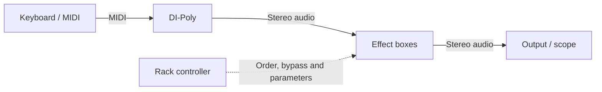

# Effects desk and independent effect boxes

12 November output continuation: the [complete master entry](MODULAR_AUDIO_ENGINE_GENERATOR_MASTER_OUTPUT.md) now passes actual stop/quick-resume/tail-resume, source/runtime successors and clean ordered retirement across nine Rust controls. Active getter-dependent fade cancellation is explicitly refused before timer changes. Sweep has a committed six-rate leaf with reload proof; prepared first use and explicit send/summing adoption are next. The normal desk remains hybrid and no deployment occurred.

12 November master-control continuation: the [Generator master adapter](MODULAR_AUDIO_ENGINE_GENERATOR_MASTER_SCALARS.md) passes the grouped desktop application run with six role controllers plus Rust trim/ambience gains, stable source/runtime successors and clean actual release. Stored mix/ambience edits reserve both owners before publication. FDN teardown and Offline readiness now pass, and the independent master-output component is committed. The normal desk remains hybrid; sweep/send/summing, master-fade application wiring and delayed Room/Freeze adoption remain explicit. No new phone checks or deployment are required for this checkpoint.

12 November integration checkpoint: actual cold Main Generator controls, source
swaps, terminal timing-failure cleanup and save/reload pass. Complete FDN
frontend and continuous Worker Freeze leaves are committed; their explicit
latency/lifecycle and realtime admission limits are recorded in the engine
handoff. The coherent desktop build passes 85 provenance checks and the tracked
suite passes 784 files /6,578 tests, with four skips. Existing desk defaults and
legacy DSP remain operational; no deployment occurred.

12 November port continuation: the current [engine handoff](MODULAR_AUDIO_ENGINE_HANDOFF.md)
records accepted Rust Main controls, prepared Room capacity and stopped source/return
ownership. Desktop checks are grouped; no repeated phone settings or per-preset
listening is required for these internal steps. The normal workbench remains
hybrid and keeps its existing defaults. No deployment occurred.

M4c foundation update (2026-11-10): [owned basic-kit configuration](MODULAR_AUDIO_ENGINE_M4C_KIT_CONFIGURATION.md)
prepares selected palettes/per-drum controls in the opt-in graph, retaining the
actual kick bus and byte-identical legacy percussion ABI. Exact configured PCM,
reset/persistence/independence, worker buses and allocation checks pass. This
does not change effects desk audio or add a new desk sidechain. Next is the
finite All Wasm-kit adapter through its existing external effects/mixer path.
That [finite All adapter](MODULAR_AUDIO_ENGINE_M4C_ALL_KITS.md) now works, with
actual six-source desktop output and phone Hand+three-core diagnostic listening
accepted. Existing effects desk and legacy DSP remain unchanged; no new
sidechain route or normal transport migration is inferred.

M3k update: [run-bound listening records](MODULAR_AUDIO_ENGINE_M3K_LISTENING.md)
now support local save/review/JSON export without changing playback settings or
automated results. User reports Short / 96 kHz / +2 helps while open but is
insufficient locked; Default and Medium / 48 kHz / Message tasks / +2 / three
workers work while locked (128 / 64 ms declared buffering). These reports lack
a matching run export; no cause/default change is inferred. Legacy DSP stays intact.

M3j update: [packet-arrival diagnostics and explicit headroom](MODULAR_AUDIO_ENGINE_M3J_ARRIVAL_HEADROOM.md)
retain original defaults. Short / 96 kHz with +2 or +4 PCM blocks passed three
measured desktop trials each without transport misses; original capacity failed
all three. +2 declares 16 ms buffering. Phone listening remains unverified.
Legacy desk/All DSP remains intact.

M3i update: [message-task scheduling](MODULAR_AUDIO_ENGINE_M3I_TASK_PUMP.md) is
an explicit experiment; existing timers remain the harness default. It did not
remove Short / 96 kHz misses. Negative trials are retained; no quality or
performance improvement is claimed. Legacy desk/All audio remains intact.

M3h update (2026-11-09): the opt-in worker harness now measures contiguous
ready PCM lead per worker and coherently, with terminal drain separate and
selected-rate profile trials. The user reports Short / 96 kHz crackling; the
other tested combinations work well. Defaults and desk DSP remain unchanged.
See [queue-lead evidence and next task](MODULAR_AUDIO_ENGINE_M3H_QUEUE_LEAD.md).

## Engine foundation update (2026-11-09)

The next phase is specified in
[MODULAR_AUDIO_ENGINE_PLAN.md](MODULAR_AUDIO_ENGINE_PLAN.md), with a fresh-session
[implementation handoff](MODULAR_AUDIO_ENGINE_HANDOFF.md). Establish portable
contracts and a small single-thread Rust graph, prove real synth modulation and
sidechain, then benchmark six-engine worker rendering before broad migration.
The catalogue below remains the device-level port specification; the engine
plan supersedes its implementation order. **M0 audit/M1 reference graph are now
delivered** in an opt-in tool; see the engine plan's delivery record. Existing
desk DSP/defaults remain intact. The opt-in M2 slice now adds an owned real
percussion adapter, actual kick tap and separate program/key compressor with
validated timing/persistence. These are not yet wired into the effects desk;
the device integration acceptance below remains applicable. M3a now supplies
the [actual six-role serial baseline](MODULAR_AUDIO_ENGINE_M3A_BASELINE.md),
including real Web Audio program/key inputs and a kick-keyed full-route variant.
The [M3b owned FM adapter](MODULAR_AUDIO_ENGINE_M3B_OWNED_FM.md) now supplies
second/bass in an opt-in paired worklet. [M3c owned core](MODULAR_AUDIO_ENGINE_M3C_OWNED_CORE.md)
now supplies lead/rhythm/pad in an opt-in trio. [M3d pitched DAG](MODULAR_AUDIO_ENGINE_M3D_PITCHED_DAG.md)
now owns all six sources, timed notes, prepared transitions, mixing and keyed
compression in one Rust graph. The comparison retains existing local/master
effects; a separate dry Rust mix can be auditioned. [M3e bounded worker transport](MODULAR_AUDIO_ENGINE_M3E_WORKER.md)
now runs that complete graph in one dedicated worker with explicit buffering,
miss/drop counters and serial startup fallback. [M3f three-worker sources](MODULAR_AUDIO_ENGINE_M3F_SOURCE_POOL.md)
now adds a bounded source partition with coherent frame publication and a
dependent Rust master in the worklet. General distribution and desk migration
remain future work. Foundation through M3c committed locally as `bc4e35d`, M3d
as `fa634f5`, M3e as `646183d`; every completed step now ends with a local
commit. [M3g buffering profiles](MODULAR_AUDIO_ENGINE_M3G_BUFFER_PROFILES.md) adds
explicit smaller opt-in delays, repeated delivery measurements and session
persistence; default buffering and desk routes remain unchanged. M3f checkpoint:
`714ce43`. No push/deployment.

## Next phase: sidechain and device connection contract (2026-11-09)

This is the current forward plan. The chronological records below describe
delivered work and superseded design iterations. The ports in this section are
proposed virtual connections; they are not implemented jacks or hardware CV.
No new DSP or graph implementation is claimed by this planning update.

### Current inventory and remaining work

All 23 current processors have bench boxes: Clean Boost, Overdrive, Fuzz,
Saturation, Equalizer, Filter, Z-plane, Compressor, Limiter, Phaser, Flanger,
Chorus, Tremolo, Vibrato, Ring mod, Delay, Reverb, Shimmer, Freeze, Pitch,
Width, Crusher and Tape. Scope and Spectrum are two additional monitor devices.
Delay and reverb are independent, as are repeated kinds across parallel buses.
This does not mean all future capabilities are implemented: the compressor has
no external sidechain, the limiter pedal remains a native compressor-based
approximation, and the separate desk limiter is sample-peak, not true-peak.

Original device-level order (now preceded by the engine foundation above):

1. **Real sidechain compression and a real key tap.** Establish program versus
   detector inputs, connection state, latency and tap semantics before cables.
2. **Port descriptors and one routing authority.** Expose actual connections in
   headers; adapt existing serial/parallel files into the same versioned model.
3. **Independent arbitrary instances, mixer sends/returns and modulation.**
   Remove the one-kind-per-bus limit; support useful split, sum and monitor taps.
4. **Patch editing with static cables and accessible menus.** Add/remove devices,
   repatch while playing, validate before swapping graphs, preserve tails/notes.
5. **Shared table and cable physics.** Keep simulation off the audio thread and
   offer static/reduced-motion cables. Layout remains independent of routing.

The remaining sequencer backlog is separate: assignable independent tracks,
common length/rate and expression workflows, quantized launch/snapshots,
automation recording, track MIDI/clock routing, note capture and MIDI files.
Two global LFOs/eight modulation lanes already have a software foundation; that
is not yet a general patchable control system or two LFOs per arbitrary track.

### Sidechain milestone: build before general patching

Upgrade the compressor contract to `program.in` (mono/stereo audio),
`detector.in` (mono/stereo audio, detector-only role), and `audio.out` (stereo).
A detector cable is an audio edge with a detector purpose; it never becomes
another audible input to the output mixer. The current native
DynamicsCompressorNode cannot accept an external sidechain
([Web Audio specification](https://www.w3.org/TR/webaudio/#DynamicsCompressorNode)).
Implement owned Rust DSP under the common module contract, with a two-input
AudioWorklet adapter where needed and no render allocations. Reuse existing
engine/build conventions without creating an incompatible routing model.

- Keep threshold, ratio, knee, attack, release, output and blend. Add key mode
  Internal / External / Auto, detector HP filter and clear program/key/reduction
  meters. Peak detection first; RMS/hold and key listening can follow when their
  processing/monitor paths exist. Keep manual output gain predictable.
- Link gain reduction across L/R. Detect stereo key energy without averaging
  signed samples, so anti-phase key material cannot cancel its own detection.
- Auto selects External when the graph has a detector cable and Internal when
  it does not. Silence or an empty worklet input buffer must not switch sources.
  Explicit External with a missing cable releases gain reduction and shows a
  missing-key state. Repatch and mode changes are smoothed.
- Carry connection state separately from sample buffers. Report fixed latency
  in samples; delay the parallel dry path equally when using lookahead/blend.
  General parallel latency compensation is a later graph task; modulation's
  changing phase/delay cannot be presented as automatically corrected.
- Preserve the old native compressor for legacy files unless explicitly
  migrated to the new DSP version. Do not silently change an existing sound.
- Add an actual kick/key tap first. Default key tap is post-mute, pre-solo and
  pre-fader: the kick fader does not change ducking, muting it does, and soloing
  the pad does not destroy its detector. An explicit pre-mute Ghost option may
  keep inaudible triggers; ordinary sends follow their documented mute policy.
- First UI can select a source/tap from a connection menu. Persist that detector
  edge with stable IDs now, so cables later edit this same routing information.
  Include detector dependencies in cycle validation; post-compressor feedback
  into its own detector is not an unrestricted first-pass connection.

Acceptance: a steady stereo program ducks to an independent pulsed key; the
key is never audible unless a deliberate listening path is enabled. Verify
anti-phase keys, silent/absent keys, equal L/R reduction, attack/release/knee,
level/blend, bypass, key mute/solo/fader policies, hot rewire, disposal,
save/reload and legacy sound preservation at 44.1/48/96 kHz. Include source/key
timing and latency in the native audit, rather than just checking GUI values.

### Common port rules

Each port has stable object-local ID, direction, signal family, channel count,
units/range where applicable, supported rate, fan-in policy and semantic role.
Connections refer to instance/port IDs, never labels, positions or chain indices.
Graph edges also carry channel mapping, modulation depth/polarity/offset and
tap point where needed. Distinguish these signal families:

| Family | Contract |
| --- | --- |
| Audio | Mono or stereo PCM; program and detector roles share the audio type but have different destinations. No implicit stereo-to-mono sum. |
| CV/control | Pitch in semitones or a declared normalized/bipolar control range. Convert to a parameter through an explicit mapping, attenuation and clamp. |
| Gate/trigger | Gate is held state, trigger is an edge/pulse. Declare thresholds/pulse width and reset state on disconnect. |
| Clock/transport | Timed clock, reset, run/start/stop and phase; declare pulse resolution and one elected clock authority. |
| MIDI/event | Timestamped notes, releases, channel, CC, bend, pressure and optional clock; preserve note ownership and prevent echo loops. |
| Power | A later virtual supply/enable contract, independent of signal routing. Model it only when disconnection actually changes device operation safely. |
| Pattern/harmony | Generator-to-sequencer pattern/harmony data with quantized handover; neither audio nor an extra stream of duplicate live notes. |

L, R and Stereo are views of one stereo bus, not three separately mixed outputs.
L/R breakouts may legitimately branch elsewhere. Reject overlapping alias
connections into the same destination channel, which would double its level.
Mono into stereo uses an explicit/declared normalization policy; L-only input
can feed both processing channels, while a connected R preserves real stereo.
An ordinary input takes one source. Summing uses a mixer/merge node; source
fan-out is allowed without changing its gain or making duplicate target paths.

Internal CV is not an electrical output. A hardware bridge would need supported
hardware, calibration, voltage/polarity ranges and a separate implementation.
MIDI software ports likewise need explicit bridges to selected hardware ports.
Hide unsupported sockets rather than drawing active dummy jacks.

### Proposed device connections

| Device | Inputs | Outputs and constraints |
| --- | --- | --- |
| Keyboard/controller | Hardware/virtual MIDI IN; optional clock/reset for its arp | MIDI OUT for locally played/arp notes, MIDI THRU for received events; optional mono pitch CV, gate and velocity CV follower. No audio output. |
| Pitched synth | MIDI IN; pitch CV IN + gate IN + velocity CV IN; MOD IN 1–4; power later | Main Stereo OUT with L/R views. MIDI OUT only for actual generated events/CC feedback; MIDI THRU only when forwarding is implemented. Optional note-CV/gate OUT and envelope/LFO OUT need defined mono/voice-selection or poly-bundle semantics. Audio IN only for synths that actually process external audio. |
| Drum synth/machine | MIDI IN, clock/reset, named trigger inputs and selected CV parameters | Main Stereo OUT; isolated voice outs where the engine supports them, prioritizing a kick/key tap. MIDI OUT for generated notes only; THRU for received events. A sequencer trigger is not itself a kick audio signal. |
| Sequencer | MIDI IN for record/control/clock; clock/reset/run IN; transpose CV and optional fill/record trigger | Exactly eight assignable CV OUT and eight gate/trigger OUT initially; MIDI OUT and THRU; clock/reset/run OUT. The internal LFO/lane sources can be assigned to these CV sockets or explicit software modulation links. No audio output. |
| Generator/arranger | Clock/transport reference and explicit musical settings/data | Pattern/harmony link into the sequencer. Generation does not independently sound the same notes through another MIDI cable. |
| Eight-channel mixer | Eight mono/stereo channel inputs, two stereo aux returns initially, master insert return; channel insert returns when implemented; optional MIDI control | Master Stereo OUT with L/R views, monitor/cue OUT, eight direct/tap OUT, two stereo aux-send OUT, master insert send, optional channel insert sends/subgroups. Expand auxes only with real buses. CV/MIDI mapping for faders/pan/mutes needs the same parameter-target layer as pedals. |
| Ordinary pedal | Main mono/stereo IN with L/R views, one or two assignable MOD/EXP IN where useful; power later | Main Stereo OUT with L/R views. Channel behavior belongs to the processor descriptor; a mono source must not accidentally discard an existing stereo image. |
| Sidechain compressor | Program mono/stereo IN; separate mono/stereo KEY IN; optional parameter CV | Stereo OUT with linked reduction; detector/envelope telemetry may become a declared control OUT later. Key does not enter the program sum. |
| Scope/spectrum | Stereo monitor IN with L/R views; optional scope trigger IN | Terminal tap by default, with no audio output needed. Optional hard THRU must be an explicit pass-through alias. Removing/hiding the monitor must not interrupt the source. |
| Output/interface bridge | Main stereo audio IN, optional cue IN | Selected browser audio destination; optional real hardware channel/device routing only where supported. Monitor meters must describe their actual tap. |
| Splitter/mult | One typed audio/CV/event input | Several equivalent outputs; no hidden gain change. MIDI fan-out needs loop protection. |
| Stereo breakout/merge | One stereo pair or two mono channels | Explicit L/R extraction/assembly; a merge is not the same as summing L and R to mono. |
| CV utility | CV plus optional trigger/clock | Attenuvert/offset, scale, clamp, quantize, sample/hold or slew output. Add an envelope follower for audio-to-CV and an explicit trigger-to-envelope/duck adapter. |

Pitch CV + gate initially represents a monophonic voice stream. MIDI continues
to carry chords. Polyphonic CV needs explicit voice bundles/allocator semantics;
it must not silently choose or average arbitrary notes. Existing per-voice synth
LFOs/envelopes cannot be advertised as one global output without specifying
which voice, or adding a separate device-global source.

MIDI OUT contains local generated events and explicitly enabled soft-thru;
THRU forwards incoming events without generating a second copy of local notes.
Never enable both paths into the same synth by default. Disconnecting an event
route releases only notes/sustain owned by that route and cancels its scheduled
events. Reject event echo loops as well as unprotected audio/control cycles.

### Pedal channel and control capabilities

| Group | Audio contract | Additional useful connections |
| --- | --- | --- |
| Boost, overdrive, fuzz, saturation, EQ, filter, crusher, ring, tape, pitch, vibrato | Stereo-capable in/out; mono-compatible. Specify dual-mono versus linked controls and actual latency. | MOD/EXP targets such as drive, cutoff, rate, depth or interval. External ring carrier is a later extra audio input, not something the present oscillator-only ring pedal already supports. |
| Phaser, flanger, chorus, tremolo | Stereo in/out, preserving defined stereo spread/phase behavior | Rate/depth CV, clock/tap input; phase-reset input only when implemented. |
| Delay, reverb, shimmer, freeze | Stereo input/output contract; explicitly audit each algorithm's channel and tail behavior | Delay clock/tap; freeze hold/capture trigger; decay/mix/size CV as appropriate. Do not require every pedal to expose every kind of timing input. |
| Width | Stereo in/out; mono can pass but cannot be treated as an existing wide image | Width CV; correlation/mono checks remain important. |
| Compressor/limiter | Stereo-linked gain handling; mono-compatible | Compressor KEY input; detector HP control. A future true-peak limiter is a separate algorithm milestone. |

MIDI IN on a pedal is useful when CC/program/clock handling is implemented.
Ordinary pedals do not all need MIDI OUT/THRU or note CV/gate inputs. General
MOD/EXP ports map to stable parameter IDs through per-cable amount/inversion;
they do not add meaningless rows of permanently unused sockets.

### Sequencer LFO and automation routing

Reuse the existing two LFOs, eight step lanes and random source. At present they
are software/control-rate modulation, evaluated by a 20 ms timer against the
audio clock; they are not exported, sample-accurate CV cables. Preserve those
saved assignments as adapters while introducing the port model.

Example: assign CV OUT 7 to LFO 1, patch it to the synth's MOD IN 1 and map that
input to cutoff with a bounded depth. Assign CV OUT 8 to LFO 2 and patch it to
chorus rate. The other six CV outputs remain available for pitch/other sources;
MIDI note tracks can still play chords independently. An eight-step lane may
drive any of the same assignable CV sockets instead. A later expander can add
sockets; this is not an implicit promise of 8 pitch + 8 extra modulation outs.

Transport-synced LFOs carry tempo, phase and reset policy; free-running LFOs
explicitly ignore transport reset. UI rendering is not the signal clock. Smooth
control-rate targets on the audio timeline; use render-thread signals for
sample-accurate gates and any advertised audio-rate modulation. Targets must
declare supported rate and units, with Hz/log/dB/pitch conversion handled by the
mapping layer. Not every existing Wasm parameter can accept audio-rate CV.

Effective parameter values combine the saved knob setting with mapped control
offsets, with saturation/clamping and a live indicator. Disconnect restores the
base value without rewriting it. Multiple sources require explicit summing or
distinct modulation inputs, with an amount per connection. The same source can
fan out to several targets with independent amounts. Persist source, target,
mapping and clock/reset behavior, not frame-by-frame generated control values.

These connections should be usable through menus before cable gestures exist.
Sidechain, aux sends and modulation then exercise one graph contract, instead
of becoming three incompatible routing systems later.

## Parallel wet/dry demonstration — implementation plan

Requested after the single-case DI-Poly correction. Implement in this order:

1. Put overdrive/fuzz in the existing narrow pedal enclosure; persist rack
   visibility independently of audio routing.
2. Add a versioned parallel-bus setup alongside the compatible serial setup.
   Fan the stereo source into Dry, Drive and Wet mixer inputs. Dry has no
   outboard processor. Drive starts with Overdrive. Wet starts with Z-plane,
   chorus-heavy modulation, then Delay. Qualify instances by bus so Wet Delay and Master
   Delay own separate parameters, DSP, bypass, tails and object identities.
3. Reuse ChannelMixer and createMixerAudio from All, with three input strips
   and a master strip, omitting All's unused ambience/music subgroup. Retain
   real trim/filter/EQ/pan/fader/mute/solo and stereo post-fader meters. Place the
   master outboard chain after width/balance, before master level and the final
   limiter, so the master fader also silences effect tails.
4. Add a selectable parallel preset, movable mixer, lane selection/order/add/
   remove in the rack, visible branch/master pedal boxes, and final output
   Scope/Spectrum. Save/reload all bus settings, mixer state, visibility and
   poses; older serial files retain their sound. Prepare mode switches before
   fading between complete graphs; never stop held notes just to switch setups.
5. Test fan-out/summing, independent duplicate delays, mixer routing, disposal
   and stale asynchronous allocation, import rejection/migration, UI edits and
   persistence; run the suite/build and verify the real browser audio graph.

Routing is deliberately an acyclic three-input bus graph in this milestone.
The rack remains its routing authority; free-form cables, arbitrary feedback
and duplicate kinds within a single bus remain later work. Z-plane belongs on
the Wet branch before chorus/delay so it colours that texture while retaining a
dry reference and an unfiltered drive. Delay retains the already processed
chorus signal plus its echoes. The master delay/reverb should be subtle by
default: they process the entire sum, including the dry channel. A permanently
dry final output would instead need a dedicated effects-return/auxiliary path.
Parallel correlated branches can change tone and level when summed; start the
drive/wet faders low and retain the final sample-peak limiter. Do not claim
automatic latency/phase alignment for the nonlinear branch.

Prepared 2026-11-08, before implementation of the effects desk. This is the
reviewable follow-on to `SYNTHS_ALL_WORKBENCH_PLAN.md`. The object/layout
foundation, playable desk, movable control boxes and first effect-face overhaul
are delivered, including independent delay/reverb routing on the local bench.
The first gain/drive milestone also delivers a versioned bench chain and Boost,
Overdrive and Fuzz. The parallel milestone adds independent duplicate processors
across three buses. See the completion records below. Duplicate kinds within one
bus, arbitrary monitor taps, typed connections and cable interaction remain
follow-on work.

## Starting point before Stage A

- `/synths/effects` previously discovered synth tabs with BroadcastChannel and
  edits their racks. It does not host an instrument or stream their audio.
- `graph.js` owns the real stereo audio graph beside each source. Several
  contiguous insert effects share a masked Wasm instance. Delay and reverb
  ordinarily share a space processor; a split path already handles reverb-first.
- `order.js` encodes one instance of each effect kind, plus fixed-position tail
  units. This representation cannot express duplicate delays, arbitrary cable
  routing or fully independent processors. Keep its adapter for existing patches.
- `rackParts.jsx` already exposes useful controls for 19 effect faces. Reuse the
  parameter definitions, presets and proven audio paths instead of replacing
  their sound during a visual redesign.

## Stage A: make the effects page a playable desk

- Reuse Desk, StageKeys, MIDI/computer-key input, phrase audition and the existing
  DI-Poly voice editor. One local AudioContext owns synth, rack and output.
- Start with a dry DI-Poly patch so its internal effects do not obscure the
  outboard chain. Preserve editable synth patches and keyboard expression.
- Place the synth, keyboard, rack controller and output/scope as independent
  objects using the shared ID/layout model. Give the desk its own storage key.
- Keep the existing remote-rack mode available through an explicit Local / Remote
  source choice. Selecting a remote target edits that target's rack; it does not
  suggest that remote audio can travel across a drawn local cable.
- Save/load the local sound, rack and object layout; import old rack presets
  through an adapter. Do not alter the All workbench's musical setup.

Acceptance: loading the page alone is sufficient to play DI-Poly through the
rack, change its patch and hear each enabled effect; reload restores it stopped.

## Stage B: individual boxes with the rack controlling the chain



- Spawn one movable/rotatable box per active effect face. Each has a stable
  instance ID, shared parameter state, bypass and a useful compact interface.
  Moving a box never changes routing. Closing its editor never bypasses sound.
- The rack controller remains the authority for add/remove, ordering, presets,
  global bypass, levels and wet/dry. Selecting a rack tile reveals/focuses its
  box. The chain display names the same instances as the boxes.
- First expose the existing DSP as separate control boxes; label this delivery
  accurately. Then introduce a processor-instance registry with per-instance
  parameters, reset, bypass/tail policy, allocation and disposal. Only that
  second step unlocks duplicate effect kinds and unrestricted ordering.
- Preserve the old chain's exact order and settings during migration. Split
  delay/reverb and release fixed tail ordering only after equivalence tests.
- Keep a small common shell: connection strip, name/accent, status/bypass,
  essential controls and measured units. Advanced controls use a second page
  or expandable section. Knobs match display colors; controls remain usable
  at normal desk zoom with pointer, touch and keyboard input.

## Stage C: effect-by-effect interface and capability pass

These are candidates, not promises of existing DSP capabilities. Start by
surfacing useful controls already present; additions requiring engine changes
need their own audible verification and bounded CPU/tail measurements.

| Box | Clean primary face | Proposed additions / focused work |
| --- | --- | --- |
| Saturation | Drive, mix, output, input/output meters | Gain compensation and selectable transfer shapes; keep the current shape as a compatibility mode |
| EQ | Frequency/gain controls with a response display; focused band's Q | Band bypass and more practical band selection; additional bands only after DSP/CPU review |
| Filter | Type, cutoff, resonance, gain where applicable | Display slope clearly, hide irrelevant controls; tempo/envelope modulation as a later extension |
| Compressor | Threshold, ratio, attack, release, makeup, mix; gain-reduction meter | Easier soft/hard knee editing; detector/sidechain filtering requires an engine extension |
| Phaser | Rate/sync, depth, center, feedback, mix | Clear stage/spread controls; tempo sync and manual sweep |
| Flanger | Rate/sync, depth, delay, feedback, mix | Through-zero/manual control only if implemented and audibly validated |
| Chorus | Rate, depth, width/spread, mix | Distinguish stereo spread from feedback; sync and optional voice modes |
| Tremolo | Rate/sync, depth, stereo spread, mix | Shape and phase options; show the modulation visually |
| Delay | Time or division, feedback, tone, mix, ping-pong | Tap tempo, bounded freeze and independent input/feedback filtering; preserve existing ducking and send-to-reverb migration |
| Reverb | Type, decay, size, pre-delay, damping, mix | Advanced early reflections, width, modulation and quality; per-box tail clear/freeze only when supported |
| Crusher | Bits, sample division, mix, output | Clear effective sample-rate display and level compensation; optional dither/filtering later |
| Ring modulation | Frequency, mix and output | MIDI-note frequency tracking and stereo phase as optional extensions |
| Pitch | Semitones, cents, mix | Make latency/quality limits visible; stereo-aware processing and interval presets before pursuing costly algorithms |
| Width | Width with mono/stereo and correlation indication | Bass mono/width split and safe gain handling; do not describe it as a full spatializer |
| Limiter | Ceiling, reduction and output meters | Document current algorithm; lookahead/release controls or true-peak operation require a dedicated processor pass |
| Tape | Drive, wow/flutter, tone, output | Expose missing flutter-rate/detail controls, gain compensation and optional noise; noise defaults off |
| Shimmer | Mix, decay, interval, climb, tone | Independent input, tail management and bounded feedback; preserve existing interval sound |
| Freeze | Capture/hold, mix, length, fade | Clear live/frozen status and retrigger; audition held audio and define release/tail semantics |
| Z-plane | Shape A/B, morph, shift, resonance, mix, response display | Make custom-node editing accessible in an advanced view; modulation targets and shape presets |

Suggested order: shell and meters -> EQ/filter/compressor -> delay/reverb ->
modulation -> saturation/tape/lo-fi -> pitch/shimmer/freeze/Z-plane. Finish one
representative insert and one tail effect before expanding the visual system.

## Stage D: connection headers and a typed routing model

Example strips: DI-Poly exposes **MIDI IN · AUDIO OUT**; an ordinary delay
exposes **AUDIO IN · AUDIO OUT**. Each jack names its connected endpoint and
shows activity. A later MIDI-controlled delay can add MIDI IN when that event
route actually exists. Keep this strip separate from the effect's main knobs.

- Add a narrow top connection strip to object shells. Stereo Audio IN/OUT jacks
  show connected count and signal activity; MIDI IN/OUT show event activity.
  Use text/icon shapes as well as color. Labels distinguish input from output.
- Only show ports the object implements. DI-Poly has MIDI input and audio output;
  an ordinary audio effect has audio input/output, with MIDI/control input only
  when supported. Output has audio input. Reserve power/control types in the
  schema; do not show illuminated dummy connections or pretend power is audio.
- Port IDs derive from stable object ID plus local port identity, never current
  chain position, display label or object angle. Jack locations are object-local
  coordinates transformed into desk coordinates for rendering/hit testing.
- During rack-controlled operation the strip is a read-only view of actual chain
  connections. A readable route list is the keyboard-accessible alternative.
- Add a versioned typed patch graph and build the serial rack's chain as graph
  edges. Validate direction/type/channel compatibility, duplicate paths, missing
  endpoints and cycles before changing audio. Prepare processors first, then
  publish a complete rewire with fades and a documented tail policy.

## Stage E: user patching and dynamic boxes

- Add effect from a palette -> create a processor instance -> place its box ->
  connect its supported ports by cable or accessible connection menu.
- Introduce an explicit **Rack chain / Patch** routing mode. In Rack mode the
  controller owns the serial route; in Patch mode both its route view and cable
  gestures edit the same graph. Never maintain competing routing authorities.
- Support fan-out/mixing only through defined semantics and mixer/splitter units.
  Begin with acyclic audio graphs; feedback needs dedicated delay protection.
- Start with lightweight static cable curves, highlighting and reconnect previews.
  Add bounded physics afterwards, off the audio thread, with slack, damping,
  reduced-motion mode and zoom/rotation-safe endpoints.
- Versioned persistence includes instances, parameters, ports/edges, poses,
  visibility and z order. Test deletion, failed allocation, held notes, bypass,
  tail clearing, rapid rewire and power cycling before integrating into All.

## Review checkpoints

1. Playable local desk with the old rack sound retained.
2. Rack-controlled movable boxes: one insert and delay/reverb demonstrated.
3. Effect interface/capability choices reviewed against actual sound and CPU cost.
4. Independent processor instances and compatible setup migration.
5. Connection strips and serial graph, then dynamic patching, then cable physics.

No full stompbox migration, new DSP features, connection header, dynamic routing
or cable physics is delivered by the current object/layout foundation pass.

### Stage A implementation plan (2026-11-08, before implementation)

The user has authorized the playable effects desk. Default `/synths/effects/`
will host a local DI-Poly voice, the full rack controller, a keyboard and an
output panel, with optional scope and MIDI/setup. Reuse the real DI-Poly engine,
Performer, StageKeys and RackPanel. Keep synth patch choice independent of the
rack being tested. Start from a dry source patch; retain existing rack presets,
add/remove/order, bypass and parameter controls. One local engine owns the full
audio route and output monitor.

Use the shared object registry and floating gestures, with effects-specific
objects, state, keyboard/setup preferences and camera storage. Add an isolated
layout-reset path so this desk cannot erase All's layout. Export/import the local
sound, rack, keyboard/audition settings and object layout, validating the whole
file before applying it. Reload/import leaves audio stopped. Preserve existing
`?target=` remote links and remote control through an explicit source switch.
Leaving Local cancels held notes/phrases and disposes a pending or live engine.

Verify first-key startup/release races, failure/retry, unmount during loading,
live source and rack edits, patch/rack independence, keyboard/MIDI routing,
remote target selection, persistence and malformed import. Then run the full
suite/build and browser checks including real output scope samples. Independent
stompboxes, new DSP, connection headers and cables remain later stages.

### Stage A delivered: playable local effects desk (2026-11-08)

- `/synths/effects/` now opens a local workbench with the full DI-Poly editor,
  keyboard/audition dock, existing full rack controller, stereo output meter and
  optional scope/setup. The synth, rack, keyboard, output, scope and setup have
  stable object IDs and independent movable/rotatable poses. Spread arranges
  measured visible objects. Existing remote links (`?target=…`) and the remote
  rack controller remain available through the explicit source switch.
- The local engine reuses `startDiySynth`: DI-Poly -> existing rack -> output
  monitor -> destination, with the same AudioContext. Reference patches have
  their insert/space effects and voice chorus cleared; choosing a source patch
  keeps the desk rack's order, settings and bypass state. No DSP was rewritten.
  Existing rack recipes, add/remove/order, effect controls, bypass and tails
  remain usable for subsequent single-effect rework.
- The Performer handles touch/computer/MIDI notes, sustain, expression,
  aftertouch, wheel, ribbon and pad. First-key/phrase input starts audio; loading
  races cannot revive a released note or cancelled phrase. Leaving Local,
  stopping, failure/retry and unmount dispose pending or live engines safely.
  MIDI access is requested only through Connect MIDI.
- Effects-specific local keys retain the patch, rack, keyboard/audition settings,
  visible panels and object layout. The desk camera and layout reset are scoped
  to this environment. Reset here does not clear All's song or shared camera.
  Save/Open desk exports a validated version-1 `calmbgm-effects-desk` document;
  import validates before stopping/replacing the current state. Malformed files
  leave the current desk usable. Reload and valid import leave audio stopped.
- Browser QA played a chord through the real output and captured nonzero 48 kHz
  PCM through Scope's WAV export. Setting rack output to -24 dB changed the live
  peak readout from -17.9 to -41.9 dBFS; independent short mono scope captures
  measured -22.69 dB RMS change. These are 20 ms captures of a running phrase,
  not sample-aligned null comparisons. Saturation at 100% mix / +12 dB drive
  also produced live output; a WAV snapshot is retained. Switching Five-voice
  brass -> Eight-voice silk preserved the entire rack across reload. Portable
  import restored the original source and left audio stopped.
- Five visible surfaces spread with zero overlaps; IDs survived reload, and
  scoped Reset returned their home poses. The browser reported no warnings or
  errors during the final checks. The desk is left with the dry Five-voice brass
  source, clean neutral rack, output at 0 dB and stopped audio. All's musical
  setup was not replaced.
- Verification: **351 files / 2,570 tests passed** (117.46 s). Final focused
  regression: **12 tests passed**; production build passed (37.49 s), as did
  `git diff --check`. Coverage includes first-key release races, MIDI/control
  routing, patch/rack independence, cancellation, stale loads, runtime failure
  retry, remote target selection, isolated layout reset, local reload, valid
  setup import and invalid-file rollback. Logs: `.tmp/effects-desk-full.log`,
  `.tmp/effects-desk-final-regression.log`, `.tmp/effects-desk-build-final.log`.
  Browser evidence: `.tmp/effects-desk-final.png`,
  `.tmp/effects-desk-{edited,reloaded,final}.json`,
  `.tmp/effects-desk-{dry,minus24,saturation}.wav` and
  `.tmp/effects-desk-audio-report.json`.

Physical MIDI hardware, direct listening, touch hardware, cross-browser behavior
and audio-device underrun measurements were not verified. This is the playable
reference environment for the next effect-box pass; independent effect
processors, per-effect UI overhauls, connection strips and cable routing are
still Stages B–E. No commit, push or deployment was performed.

### Stage B control-box plan (2026-11-08, before implementation)

Proceed with rack-controlled movable effect editors. Give every supported effect
face a stable object ID, independent saved pose and explicit editor visibility.
The local rack selects/reveals/focuses boxes; add/remove/order/presets and global
bypass remain authoritative there. Closing a box changes editor visibility only.
Removing a unit hides its faces without discarding settings or saved placement;
re-adding it can restore them. Keep the current DSP/routing representation intact:
these are independent control boxes, not independent processor instances yet.

Use a common draggable/rotatable shell, accent, bypass/status, close and advanced
controls. Deliver compact physical-knob primary faces for saturation and for
both space-effect halves (delay/reverb); expose existing controls in other boxes.
Do not relabel delay/reverb sends as inserts' wet/dry, expose a shared insert trim
as a per-effect output, add fake per-effect meters, or offer unsupported MIDI or
power ports. Show readable serial neighbours from the actual rack order instead.

Extend local/setup persistence for editor views and clock tempo, preserving
older Stage A files and object IDs. Give delay sync a real desk/phrase tempo.
Verify box edits reach the same live rack, closing/moving does not bypass or
reorder, removal/re-add preserves pose and settings, selecting raises existing
boxes, shared delay/reverb removal is handled honestly, and save/reload/import
restores both controls and poses. Then run full checks/build and browser audio
and layout verification. Per-effect DSP features and processor independence
remain later work.

### Stage B independent control boxes delivered (2026-11-08)

- All **19 existing effect faces** can open as separate movable/rotatable editor
  boxes. The registry now includes their stable identities, saved poses, z order
  and visibility. Saturation opens by default when migrating a Stage A desk;
  rack tiles reveal/focus the corresponding existing editor. Show all boxes and
  Hide boxes operate on editors without changing processing. Removed units hide
  their faces while retaining settings, editor preferences and placement for
  re-add. Closing an editor never bypasses or removes its effect.
- The rack remains the authority for chain membership, order, presets, global
  bypass and tail clearing. Its local selected-effect pane now focuses the box
  and keeps routing/removal actions; other pages/remote racks retain their
  existing inline editors. Logical chain neighbours are visible on every box.
  Moving/reordering are separate operations: reordering updates neighbours but
  not poses. Delay/reverb's shared removal is explained before the rack action.
- Added compact primary faces for Saturation (Drive/Mix), Delay
  (Time/Feedback/Tone/Send) and Reverb (Decay/Size/Damping/Send), with matching
  colored readouts and physical encoders. Double-click resets a knob. Delay and
  reverb expose remaining existing controls under a saved Advanced view. Other
  effects reuse their full existing controls within the common shell, including
  Z-plane editing and compressor reduction display. All have explicit bypass
  and close controls. Memoized boxes avoid redrawing for unrelated output-meter
  updates. These are control surfaces over the **existing shared DSP**, not new
  independent processor instances or full Stage C redesigns.
- Delay sync now has a real rack clock. During audition it follows the phrase's
  tempo, and retains that tempo afterwards so stopping a phrase does not change
  delay-tail timing. Unsupported long divisions are capped at the existing
  2,000 ms engine limit and identified on the delay face. Per-effect gain/tail
  reset/meters were not fabricated over shared processors; MIDI/power ports and
  connection headers await the graph/processor work.
- Local/portable state saves effect visibility, Advanced views and clock tempo.
  Existing Stage A documents still load; missing face identities are migrated.
  Tests reject unsupported view keys and invalid tempo. One instance of each
  existing rack kind is supported; duplicate effects and arbitrary order of
  formerly fixed tail units remain future processor-model work.
- Browser QA enabled saturation and space sends on the local DI-Poly chain.
  At the chord audition's **66 BPM**, quarter-note delay showed **909 ms**;
  stopping audition retained that clock/time. Closing Saturation's editor left
  audio playing and left the entire rack snapshot unchanged. A subsequent
  48 kHz / 960-frame mono scope export measured RMS **0.07724**, peak **0.22534**.
  This proves output continued, not sample-aligned effect equivalence.
- Browser rack reordering changed serial order/labels while preserving all
  effect poses; all object records and editor views matched exactly after
  reload, with audio stopped. Spread arranged **eight visible surfaces with
  zero overlaps**. Native left-drag at about 60% zoom and keyboard rotation
  moved/rotated Saturation independently. Pre-check sound, object poses and
  editor views were restored and audio left stopped.
- Final verification: **351 files / 2,577 tests passed** (114.57 s), production
  build passed (35.49 s), and `git diff --check` passed. Focused regressions:
  **29 tests passed**, covering live knob/bypass edits, close/focus semantics,
  dragging, reordering, shared space removal, re-add, clock retention,
  persistence and Stage A migration. Logs: `.tmp/effect-boxes-full.log`,
  `.tmp/effect-boxes-integration-final.log`, `.tmp/effect-boxes-build.log`.
  Evidence: `.tmp/effect-boxes-{overview,controls}.png`,
  `.tmp/effect-boxes-{before,migrated,edited,closed,reordered,reloaded,restored}.json`,
  `.tmp/effect-boxes-live.wav`, `.tmp/effect-boxes-browser-report.json`.

Next: review/refine individual faces and introduce per-instance processors with
compatible chain migration and measured sound/CPU/tail behavior. After that,
real connection strips, typed patch routing and cable interaction/physics can
be added. No commit, push or deployment was performed.

### Full effect-box overview (2026-11-08)

- Added **Show every effect** in the effects bench ribbon. It reveals exactly one
  editor for each of the 19 effect faces, spreads the visible desk objects and
  fits the camera. The effects bench supports zooming down to 10% for this view.
- This is a presentation action: rack order, chain membership, bypass and sound
  settings stay intact. Boxes outside the current chain show **Not in chain**,
  no invented neighbours, and an **Add to rack** action using the existing rack
  model. Their controls retain settings ready for later use.
- Catalog visibility and object identity/poses survive reload and desk files;
  old files default to the normal active-chain view. Hide boxes clears the
  catalog view; Show all boxes retains its active-chain-only meaning.
- Focused integration, persistence and shared desk checks: 4 files / 29 tests
  passed. Production build passed; browser verified all 19 editors are present.

### Adaptive bench arrangement (2026-11-08)

- Added a top-ribbon **Arrange bench** action. It and the existing **Spread**
  action use the same layout as **Show every effect**: aligned rows, 64-unit
  gaps, zero rotation, and automatic fit. Row width is chosen against the
  current viewport shape rather than a fixed 3,000/6,000-unit shelf.
- Only visible mounted objects move. Hidden poses, object IDs, sound settings
  and routing are retained, and the resulting layout uses existing persistence.
- Focused desk/effects regressions: 27 tests passed, including a mixed-size
  19-effect packing check for wide/tall views, spacing and repeatability.

### Effect face and independent space pass (2026-11-08, before implementation)

- Keep the accepted saturation, delay/reverb and Z-plane faces. Replace the
  rack-fader fallback for EQ, modulation, dynamics, pitch/width, shimmer/freeze
  with compact knob/display faces. Larger parameter sets use visible radio
  selectors plus parameter/value encoders; every existing control remains usable.
- EQ gets three-band selection, frequency/gain/Q knobs and a modeled response.
  Filter shows its configured response. Dynamics shows configured transfer and
  attack/release timing separately from measured input/reduction indicators.
  Modulation/width/pitch/lo-fi displays explain current settings; no invented
  signal meters, scopes, true-peak limiting or new DSP algorithms.
- Add append-only independent routing metadata. Old numeric order, masks and
  adjacent shared delay/reverb sound remain valid. New local independent edits
  migrate to separate delay/reverb membership/order; legacy adjacent pairs may
  retain the shared kernel for exact sound. Separated/solo units use isolated
  buses. Clearly label legacy echo-to-reverb feed versus serial routing.
- Verify parameter editing, selection, reset, persistence, ordering/membership,
  bypass, asynchronous graph allocation/disposal and legacy compatibility. Run
  focused/full tests, build and browser checks, and document actual limitations.

### Compact effect faces and independent delay/reverb delivered (2026-11-08)

This record supersedes the proposed adjacent-pair optimization in the preceding
implementation plan: independent routing always allocates separate delay and
reverb processors. The shared kernel is retained only for untouched legacy rigs.

- Reworked EQ, phaser, flanger, chorus, ring modulation, crusher, tremolo,
  filter, compressor, pitch, width, limiter, shimmer and freeze, plus the tape
  fallback. Saturation, Delay/Reverb and Z-plane retain their accepted primary
  designs. No new signal-processing algorithms were added for this face pass.
- EQ has Low/Mid/High band radios, frequency/gain knobs, middle-band Q and a
  response modeled from the insert kernel's actual RBJ coefficients. Filter
  displays its configured response and shows only controls relevant to its mode.
- Larger parameter sets use a parameter encoder, value encoder, and radio
  readouts with matching accent colors. Small effects expose their knobs
  directly. All prior parameters remain reachable; knob double-click resets.
  Phaser stages use even counts. Direct one/two-knob modules place their knobs
  beside the display to avoid tall empty faces.
- Modulation, ring, crusher, pitch, width, shimmer and freeze displays explain
  settings. These are labeled setting previews/diagrams, not measured scopes.
  Freeze distinguishes a requested hold from measured buffer state.
- Compressor has a configured soft-knee transfer view, a separate illustrative
  attack/release view, an input-peak/live-reduction point and measured native
  gain reduction. Its plot is before makeup/compensation, not a calibrated
  detector-output measurement. Limiter displays measured native reduction and
  its actual 20:1 dynamics behavior; it is not a true-peak/brickwall limiter.
- Added append-only `master.routing`, `master.boxOrder` and `master.boxChain`.
  Old order ranks, bit positions, parameter IDs and setup files remain valid.
  Untouched old rigs still use their original combined space sound. A chain
  membership/order edit on the local bench activates independent serial routing;
  this can change how echoes feed reverb and applies each bus's own protection.
  The legacy echo-to-room parameter is retained in saved settings but hidden in
  independent mode, where the serial chain defines the input to each effect.
- Delay and reverb can be added/removed separately, placed either side of other
  movable units, and bypassed without discarding saved values. Removing delay
  from an already-independent rig leaves the reverb processor/tail allocated.
  The first legacy-to-independent conversion necessarily replaces the shared
  processor; its old tail is not transplanted. Structural rewires retain the
  existing brief fade policy. Fixed tail-unit ordering and duplicate instances
  remain future work. Other instrument pages keep legacy grouped editing unless
  they receive an explicitly independent rig.
- Graph loading is demand-driven: a delay-only rig allocates no reverb/combined
  bus. Newly constructed buses are masked before connection. Async regressions
  cover changed routing during loading, late allocation after disposal, reuse,
  opposite-effect masking and idempotent disposal.
- Browser checks edited EQ response and Phaser stages/sweep, observed 4–5 dB of
  live compressor reduction, and played DI-Poly with reverb-only and delay-only
  routes. Short 48 kHz / 960-frame scope captures were finite and nonzero:
  reverb-only RMS 0.10557 / peak 0.31625; delay-only RMS 0.13332 / peak 0.28967.
  These verify functioning output, not isolated wet signals, direct listening,
  sample-aligned equivalence, tail-duration or underrun performance.
- Independent routing/order and object IDs matched after reload, with playback
  stopped. All 19 faces arranged with zero overlaps. The original source/rack
  settings were restored exactly, with the new faces arranged and audio stopped.
  Browser console reported no warnings/errors during these checks. Evidence:
  `.tmp/effects-faces-{eq-phaser,overview}.png`,
  `.tmp/effects-faces-{before,split,reloaded,restored}.json`,
  `.tmp/effects-faces-{reverb-only,delay-only}.wav`,
  `.tmp/effects-faces-{audio,browser}-report.json`.

Still pending: repeated effect instances, arbitrary fixed-tail ordering,
per-instance presets/tail management for every processor kind, true patch ports,
cables, additional proposed DSP, physical touch/MIDI hardware testing and
cross-browser/audio-device performance checks. No commit, push or deployment.

Final verification for the face/space pass: **354 files / 2,596 tests passed**
(163.69 s, eight workers); production build passed (37.58 s), and diff check
passed. The initial concurrent build/test run hit Vitest worker communication
timeouts; isolated reruns completed cleanly. Final targeted routing/graph/UI
checks also passed (36 tests). Logs: `.tmp/effects-faces-all-complete.log`,
`.tmp/effects-faces-build-complete.log`, `.tmp/effects-faces-last-focused.log`.

### Pedal-size correction (2026-11-08, before implementation)

The user rejected display-heavy faces, including the ordinary filter. Replace
simple effects with genuinely smaller pedal enclosures, direct knobs/physical
switches and optional More controls. Remove decorative plots and generic
parameter-selection screens. Keep useful EQ/compressor/Z-plane displays; retain
the accepted saturation/delay/reverb faces. Preserve all values, routing and
saved object identities. Verify editing and expanded-control persistence, then
build and inspect the actual dimensions/layout in the browser.

### Pedal faces and one-row headers delivered (2026-11-08)

- Replaced display/parameter-selector faces for Phaser, Flanger, Chorus, Ring,
  Crusher, Tremolo, Pitch, Width, Limiter, Tape, Shimmer, Freeze and the ordinary
  Filter with direct knobs. No decorative plots or screens remain on these
  modules. Primary controls stay visible; More exposes the remaining parameters
  and its expansion uses the existing saved/portable view flags.
- Freeze uses a direct Capture/Hold switch; limiter keeps a small real reduction
  strip. Filter uses a type knob and mode-appropriate direct frequency/Q/gain
  knobs; cut slope is under More. EQ and compressor retain useful displays in
  narrower enclosures. Saturation, Delay/Reverb and Z-plane keep their primary
  controls. The earlier display-heavy design is superseded by this correction.
- Combined name, direct On/Off indicator/button, routing and Close into one
  header. Routing truncates visually when necessary and retains full endpoint
  names in its tooltip/accessibility text. Buttons do not initiate dragging.
  Catalog-only boxes retain Add to rack in the same header. Removed visible
  double-click-reset reminders, closing-editor prose and legacy-space notes.
  Reset remains on each parameter knob and in its existing tooltip. Removing
  the legacy note does not erase backwards-compatible saved-audio routing.
- Focused editing/persistence/graph regressions: **28 tests passed**. This is a
  presentation correction; independent delay/reverb audio routing is retained.

### Fixed physical footprints: manufacturer references (2026-11-08)

The user removed all expanding More/Advanced faces and requested proportions
based on real stompboxes. This supersedes the earlier content-sized and
near-square enclosure choices. Top-down size is **width x depth**, not the
manufacturer's standing height.

| Reference | Published W x D | Width/depth | Primary source |
| --- | --- | --- | --- |
| Ibanez TS9 | 74 x 124 mm | 0.597 | [Ibanez/Hoshino manual](https://www.hoshinogakki.co.jp/pdf/ibanez/manual/cn/electronics/TS9.pdf) |
| BOSS DS-1 (cross-check) | 73 x 129 mm | 0.566 | [BOSS specs](https://www.boss.info/uk/products/ds-1/) |
| Strymon blueSky V2 | 101.6 x 114.3 mm | 0.889 | [Strymon specs](https://www.strymon.net/product/bluesky/) |
| Strymon BigSky | 171.45 x 129.54 mm | 1.324 | [Strymon current product specs](https://www.strymon.net/product/bigsky/) |

Use a shared 2.6 desk-unit/mm scale, rounded to whole desk units: 192 x 322
compact (TS9), 264 x 297 medium (blueSky), and 446 x 337 wide (BigSky).
Z-plane uses a 540 x 408 readability-scaled version of the same BigSky ratio.
These are UI enclosure references, not replicas or claims of matching DSP.
Every device keeps its footprint regardless of control count, settings or mode.

- Compact: Saturation, Tremolo, Crusher, Ring, Pitch, Width, Limiter and Freeze.
- Medium: Phaser, Flanger, Chorus, Tape, Shimmer and ordinary Filter.
- Wide: EQ, Compressor, Delay and Reverb; larger same-ratio Z-plane.
- All pedal knobs are always present; no More/Advanced expansion. Filter keeps
  all seven controls at fixed positions and darkens mode-inapplicable knobs.
  Delay/reverb expose all non-legacy controls directly, including sync and modes.
- Fixed depths across these families reflect the manufacturers' approximately
  114-130 mm pedalboard depths rather than changing box height to fit content.

Final physical-footprint verification: **28 focused tests passed** and production
build passed (40.47 s). Browser measured every enclosure against its family;
all 19 boxes had zero overlaps, no expanding More/Advanced controls, and no
interactive controls outside their case bounds. Filter mode changes retained
all knob positions and case dimensions. The single On/Off button toggled state
correctly; closing/posing/routing retain their established semantics. Pre-check
sound settings and object identities were restored, with audio stopped.
Evidence: `.tmp/effects-pedal-footprints-{detail,overview}.png`,
`.tmp/effects-pedal-footprints-{browser,restored}.json`,
`.tmp/effects-pedal-footprints-{tests,build}.log`. These are UI-only changes;
no new audio algorithms, deployment, commit or push.

### Control hierarchy and performance footswitch pass (2026-11-08, before implementation)

The user supplied a two-main-knob pedal photo as an example of hierarchy, not a
literal skin to copy. Keep the researched fixed enclosure proportions and use
large primary knobs, smaller permanently fitted secondary knobs, quiet printed
labels and hover/focus values. Remove the three-band EQ display and conditional
band/Q hardware: all seven EQ controls stay physically present.

Every effect gets a large bottom On/Off footswitch; Freeze pairs it with Hold.
Delay and periodic modulation (Phaser, Flanger, Chorus, Tremolo, Tape wow) get a
second Tap switch. Tap changes the local effect time/rate, not the phrase clock;
Delay tap selects free time. Reject bounce taps, reset after pauses and smooth
several valid intervals. Do not mislabel reverb decay/attack as periodic clocks.

Reverb retains prominent Decay/Level/Tone controls and a fixed display with
scrollable secondary parameters plus permanently fitted Select/Value encoders.
The same fixed bank can serve complex delay settings. This replaces twelve
simultaneous reverb knobs without expanding the chassis. Compressor's assigned
encoder is visibly labeled Value and remains in place.

Audit blend controls by DSP role. Keep purposeful echo/reverb levels, saturation
parallel blend and pitch/harmony balance. Omit generic blend controls from
Phaser/Flanger/Chorus/Tremolo/Crusher/Ring faces; preserve their stored values.
When explicitly engaging a zero-blend legacy pedal, apply its standard voiced
amount so it is audibly engaged; nonzero saved blends remain unchanged. No audio
algorithm or automatic load-time sound change is authorized by this UI pass.

Verify tap interval handling, DSP mappings/range limits, fixed knob identities,
foot bypass/hold, blend preservation and save/reload. Build and browser-check
actual control hierarchy, footprints, bounds and continued audio operation.

### Next pass: gain, drive voices and stereo monitor pedals (planned)

The user explicitly chose planning these additions for the next pass. None of
these processors, independent monitor boxes or Y-cable connections ships in the
current face/control pass. Implement in this order:

1. **Stable instances and migration.** Add a versioned array of stable processor
   IDs, kinds, parameters and ordered connections before adding new kinds. Keep
   the legacy order/chain and current independent delay/reverb adapters; never
   reinterpret their factorial order ranks against a larger registry. Accept
   old desk files, preserve object identities and migrate atomically. The rack
   remains the order/connection authority until cable editing is implemented.
2. **Pure boost.** A smoothed linear gain stage with one prominent Gain pot,
   On/Off and clear headroom indication. No waveshaping or automatic makeup.
   Measure before downstream limiting. Verify expected dB gain with PCM,
   left/right independence, silent/bypass identity and edits without clicks.
3. **Overdrive and fuzz.** Separate TS-inspired mid-focused overdrive and fuzz
   models with purposeful Drive/Tone/Level controls; Bias only if the model
   implements it. Use input conditioning, oversampled nonlinear stages, DC
   removal and bounded output trim. Describe these as digital models with
   different clipping responses, not exact circuit emulations or non-digital
   processing. Preserve the existing Saturation sound and saved parameters.
   Compare response/THD, aliasing, DC, extreme settings, switching and CPU at
   44.1/48/96 kHz before choosing oversampling and processor placement.
4. **Stereo monitoring foundation.** The current output worklet passes stereo
   audio unchanged but stores a 65,536-sample mono-average history. Its client
   also has one pending callback: two independent consumers would overwrite
   one another. Replace this with bounded L/R histories and a capture broker
   using request/consumer IDs or latest-frame fan-out. Handle cancellation,
   late replies, stopped contexts and disposal without retaining consumers.
5. **Scope and Spectrum boxes.** Independently movable monitors with stable
   identities, stereo inputs, L/R views, optional mid/side/correlation and a
   clear trigger-channel choice. Their footswitch pauses monitoring, not the
   audible signal. Start with actual output taps, then expose other graph taps.
   Test left-only/right-only/anti-phase input (no mono cancellation), concurrent
   monitor requests, freeze/resume, bounded redraw/FFT cost and audio identity.
6. **Typed fan-out and Y cables.** Add real audio input/output and monitor ports,
   static typed edges and explicit fan-out before cable physics. A Y branch
   must create a monitor-only tap at the selected node without coloring audio
   or adding audible latency. Validate channel compatibility, avoid invalid
   cycles, disconnect cleanly and save connections atomically. Add MIDI/power
   indicators only when their corresponding connections actually exist.

Acceptance: old desks sound the same after migration; new gain/drive processors
have measured behavior; two stereo monitors can observe the same or different
nodes concurrently; changing monitor views never changes playback. Movable
cables, physical slack/collision and arbitrary routing remain later milestones.

### Physical controls and compact Z-plane delivered (2026-11-08)

This completion record supersedes the earlier More/Advanced, EQ-display and
header-toggle designs above. User pedal photos informed hierarchy and spacing;
no brand artwork or circuit-emulation claim is included.

- Seven fixed EQ knobs replace its display and conditional band controls.
  Ordinary pedals use large primary and smaller secondary knobs, quiet printed
  labels and values on hover/focus. Filter controls stay mounted and inactive
  modes darken. Width and Ceiling labels are centred independently of shared
  synth CSS. Fixed enclosure families remain; EQ now uses the medium family.
- Each pedal has a bottom On/Off footswitch and read-only header LED with routing
  and Close. Freeze Hold latches. Tap is momentary: two or more presses set the
  local time/rate, which remains after release. Delay tap selects free time;
  periodic Phaser/Flanger/Chorus/Tremolo/Tape wow support local tap as well.
  Tap does not reset modulation phase or change the audition/rack clock.
- Reverb and Delay use three main knobs plus permanent, vertically stacked
  Select/Value encoders. Their display offers scrolling secondary settings on
  interaction and returns after five seconds to a configured decay/timing guide.
  These guides are not measured audio displays. Knobs remain in place and keep
  their parameter assignment while the display idles.
- A new/reset local desk gives Saturation 100% blend while bypassed, so enabling
  it is audible without coloring the initial dry source. Saved blends, including
  zero, retain their values. Global rack/preset defaults remain compatible.
- Z-plane is now 540 x 337 desk units, matching the wide pedals' height. Narrower
  response and pole/zero displays leave four fixed Morph/Shift/Resonance/Mix
  knobs beside them, with On/Off directly underneath. Shape selectors, node
  counts, saved shapes and interactive node editing remain; no faders are used
  on this bench face. Other rack contexts retain their established layout.

Verification: 37 focused tests passed; production build passed (35.41 s).
Browser checks covered all 19 enclosures: no controls outside cases and no knobs
or shape rows overlapping feet. All four Z-plane controls changed values;
reverb bank editing, five-second idle return and reload were verified. Width
and Ceiling label centres matched their knobs exactly. Live DI-Poly playback
through an engaged Z-plane reached the scope at 48 kHz; the 20 ms mono scope
capture was nonzero (peak 0.4074, RMS 0.2225). This is a short signal-path check,
not stereo analysis or subjective listening validation. Earlier local tap checks
set Delay to 747 ms and Phaser to 1.37 Hz while the phrase clock stayed 66 BPM.
No browser warnings/errors were captured.

Pre-check patch, rack, setup, audition, tempo and stable object IDs were restored
and verified against the saved baseline. Audio was left stopped and boxes
arranged for the new footprints. Evidence: `.tmp/effects-final-{focused,build,full}.log`,
`.tmp/effects-final-{detail,overview}.png`, `.tmp/effects-final-audio.wav`, and
`.tmp/effects-final-{edited,restored}.json`. No deployment, commit or push.

Final suite for the physical-control pass: **355 files / 2,605 tests passed**
(142.22 s, eight workers). Production build and diff whitespace check passed.

### Gain/drive milestone delivered (2026-11-08)

This is the first implementation milestone of the next pass above (items 1-3).
Items 4-6, independent stereo monitors and Y-cable routing, remain planned.

- Added a version-one bench processor document containing stable IDs, kinds,
  enabled states, typed new-pedal parameters and an ordered connected-ID chain.
  Existing processors explicitly bind their parameters to the legacy rack;
  there is no second copy of their sound settings. This first adapter allows
  one instance per kind. It does not claim arbitrary duplicates or typed port
  edges; those still require per-instance legacy DSP and layout migration.
- Desk files now export as version two and accept version-one desks. Invalid
  processor kinds, IDs, parameters, duplicate chain members or inconsistent
  legacy routing are rejected before import. Existing processor object IDs and
  sound values survive migration. The old numeric parameter IDs, order ranks
  and chain masks were not extended or reinterpreted.
- Untouched old desks compile the same grouped legacy stages. Adding a new
  processor switches the local bench to explicit serial routing; delay/reverb
  then use the established independent buses. Structural edits can replace
  legacy shared-space tails, as documented for independent routing above.
  Rack/audio graph updates are applied together, including changes arriving
  during startup. Native stages are retained on parameter edits/reorder and
  disposed once with their owning rack.
- Clean Boost is a smoothed 0-24 dB linear gain stage, with no filter, clipping
  or makeup gain. Overdrive uses bass conditioning and a symmetric soft knee;
  Fuzz uses an asymmetric exponential knee. Both have Drive/Fuzz, Tone and Level,
  DC blocking, a flat Butterworth tone filter and native 4x oversampling. These
  are distinct digital clipping voices, not exact hardware circuit replicas.
  Initial output trims are -18/-21 dB to keep engagement levels more useful.
- The three physical boxes use the existing compact/medium enclosure families,
  large main pots, smaller output pots and bottom footswitches. Their small
  output strips measure the maximum of separate L/R analysers before downstream
  effects; anti-phase stereo cannot disappear through mono averaging. New kinds
  are available through the rack and Show every effect now places all 22 boxes.
  Closing/moving a box changes presentation only. Parameters, enabled state,
  order and object identity persist. Reset restores the new pedals disconnected.

DSP reference: the [Web Audio specification](https://www.w3.org/TR/webaudio-1.1/)
interprets low/high-pass Q in dB and defines native WaveShaper oversampling.
The first native audit caught a resonant bump from an incorrect Q convention;
this implementation uses 20 log10(1/sqrt(2)). Oversampling filters introduce
browser-dependent latency; no full graph delay compensation is implemented.
A boost/drive can exceed full scale at its output: these pedals are not limiters.

Verification:

- **357 files / 2,613 tests passed**, eight workers, 167.06 s. The focused set
  passed 42 tests covering migration, invalid import rejection, serial placement,
  retained stages, disposal, knob edits, bypass, reorder and reload.
- Production build passed (56.48 s). The native-audit helper bundles only into
  the local dist after that build; it is not a public-build entry point.
- **27 native checks / 42 offline stereo renders passed** at 44.1/48/96 kHz.
  Bypassed PCM was exact, boost maximum sample error was 1.23e-8, left/right-only
  inputs stayed isolated, and gain edits were smoothed. Tested high-drive tones
  had 12.5-14.0 dB less nonharmonic/alias energy with 4x than with oversampling
  disabled; this is a selected-tone comparison, not an alias-free claim. Tested
  DC offsets stayed below 0.001 and all extreme outputs were finite. Maximum
  offline render time was 3.7% of rendered audio duration on this machine;
  this is not a real-time CPU guarantee or a cross-browser performance result.
- Browser checks played DI-Poly through each new pedal, observed live pedal/output
  peaks, edited all control types, reordered Boost without moving its box, and
  exported/reloaded the full instance chain with audio stopped. All new controls
  fit within their enclosures. Native dragging also moved boxes independently.
  No browser warnings/errors were captured.
- Original patch, rack, setup, audition, clock and existing object IDs were
  restored and compared to the baseline. New pedals were left disconnected,
  audio stopped, and all 22 boxes arranged for browsing.

Evidence: `.tmp/drive-{focused,full,build}.log`, `.tmp/drive-native-audit.json`,
`.tmp/drive-browser-{before,edited,restored}.json`, and
`.tmp/drive-pedals-{detail,overview}.png`. Re-run the native audit with a local
production build, `node tools/buildDriveAudit.mjs`, then the Run audit button at
`/tools/driveAudit.html` on its preview server. No commit, push or deployment.

Final review added a routing invariant regression covering 441 processor/target
moves with all legacy tail units and two new pedals present. The serial adapter
canonicalizes legacy fixed-tail conventions while retaining the new processors'
slots; later parameter edits retain that order and every result remains valid
for export. Focused verification after this correction: **42 tests passed**.

### Stereo monitor milestone delivered (2026-11-08)

Items 4-5 now provide independent Scope and Spectrum boxes at the bench's real
stereo output. This completes the output-tap milestone; selecting arbitrary
processor nodes and connecting Y cables remains item 6.

- The existing output worklet passes the same stereo PCM and keeps separate
  65,536-frame L/R histories (512 KiB total). Stereo requests receive both
  channels. Legacy mono readers explicitly receive their average, retaining
  the old Scope contract on other pages. Worklet registration is shared per
  AudioContext and retries failed registration.
- A bounded capture broker matches replies by request ID, supports per-consumer
  replacement/cancellation, expires requests after 500 ms and permits at most
  eight pending captures. Scope and Spectrum no longer overwrite one another's
  callback. Closing, pausing or disposing a reader cancels its pending request;
  late replies are ignored. Stopped monitor components release their engine
  reference while retaining the last displayed samples.
- Separate movable/rotatable 446 x 337 boxes share the pedal finish. Both expose
  a real L/R Output input indicator, independent Monitor footswitch, stereo
  traces, L/R levels and correlation. View selects Stereo, Left, Right, Mid or
  Side; only explicitly selected Mid/Side views combine channels. Pausing a
  monitor never edits the rack, transport, output or processor instances.
- Scope has fixed Time/Gain/Trigger/trigger-channel/Mode knobs and a Capture
  footswitch that remains fitted but inactive outside Single mode. Re-arm first
  obtains a fresh frame boundary, avoiding an old captured clock. It then waits
  for a later rising crossing and stops requesting frames after capture.
  Normal mode indicates when it is waiting for a crossing. The readout reports
  the actual displayed duration, including partially filled startup history.
  Save WAV retains output capture as stereo PCM16, independent of the selected
  display view. This initial bench scope has no pitch-follow trigger; other
  synth pages retain the original Scope with its existing controls.
- Spectrum has fixed View/FFT/Floor/Smooth knobs, 1,024-16,384 point FFTs, separate
  stereo peaks, a Peak hold footswitch and permanently fitted Clear peaks button.
  Channel/FFT changes reset incompatible held bins. Both monitors request at
  most 20 frames/second; waveform decimation retains per-pixel extrema. Captured
  and paused scopes stop requesting; canvas backing stores resize only when
  dimensions change. No new per-audio-block sample arrays are allocated.
- Desk format three persists independent visibility and controls. Versions one
  and two migrate without changing sound/routing; the old scope object ID and
  pose survive, and Spectrum gains its own identity. Invalid monitor settings
  are rejected before import. Files store settings, not captured audio arrays.
  Show every effect also opens both monitor boxes for the arrangement pass.

Native browser audit: stereo pass-through was **sample-exact** at 44.1, 48 and
96 kHz. Concurrent 8,192/16,384-frame stereo captures retained anti-phase signals
at approximately 0.4 peak; concurrent legacy mono captures correctly averaged
those signals to zero. The live bench displayed different L/R waveforms and
spectral peaks, kept Spectrum/audio running while Scope was paused, captured and
re-armed single shots, exported a real two-channel 48 kHz / 2,400-frame WAV and
restored its controls after reload with audio stopped. Both footprints contained
all controls without footswitch overlap. All original sound/settings and existing
object IDs were restored after verification.

Evidence: `.tmp/monitor-{focused,full,build}.log`,
`.tmp/monitor-native-audit.json`, `.tmp/monitor-stereo-capture.wav`,
`.tmp/monitor-browser-{before,edited,restored}.json`, and
`.tmp/monitor-{detail,overview}.png`. Re-run the native audit after the local build
with `node tools/buildStereoMonitorAudit.mjs` and the Run audit button at
`/tools/stereoMonitorAudit.html`. No commit, push or deployment.

### Pedal finish recipe

The enclosure finish is CSS paint and shadows, not a WebGL shader. Each pedal
supplies one `--case` colour; the remaining finish is shared in effectsDesk.css.
For base colour C, the highlight is 92% C + 8% white, and the shade is 85% C +
15% black. The gradient runs diagonally through highlight, base at 48%, then shade.
Brighter outer/top borders suggest a bevel. The unblurred 7px dark lower shadow
suggests case depth, and the 13px / 22px blurred shadow seats it on the desk.

```css
.pedal {
  --case: #4c7044;
  background: linear-gradient(135deg,
    color-mix(in srgb, var(--case), white 8%),
    var(--case) 48%,
    color-mix(in srgb, var(--case), black 15%));
  border: 1px solid color-mix(in srgb, var(--case), white 25%);
  border-top: 3px solid color-mix(in srgb, var(--case), white 40%);
  border-radius: 13px;
  box-shadow:
    inset 0 0 0 2px #ffffff08,
    0 7px 0 color-mix(in srgb, var(--case), black 35%),
    0 13px 22px #0007;
  color: #f0e8d5;
}
```

Knobs are small SVG circles/pointers with a separate 0px 3px 2px dark drop shadow.
The footswitch uses concentric grey stops in a radial gradient centred at 38% 32%,
a dark rim and a small lower shadow. No photo textures, normal maps, lighting
engine or metallic shader are involved. To recreate the colour treatment in
another renderer, reproduce these paint stops and edge/shadow layers separately;
changing only C gives the different pedal colours.

Stereo monitor verification completed: **360 files / 2,624 tests passed**
(169.55 s); **42 focused tests passed** after the lifecycle/capture refinements;
production build passed (39.84 s), and the final browser/native audit passed.
The scope trace was visually checked after connecting its min/max decimation
segments into continuous lines. Original sound/routing/settings and existing
object IDs were compared against the pre-check file and restored exactly; both
monitor settings returned to their defaults, with audio stopped.

### Bench utility surface polish

The rack controller, Stereo output module and keybed now share a restrained
satin finish, fine CSS grain, recessed control bays and consistent edge depth.
The rack gives more width to the routing path, with a narrower selection bay
showing the selected effect's status and actual upstream/downstream neighbours.
The output module has a larger sample-peak readout, a segmented meter with a
matching -60 to +6 dB scale, and a properly horizontal output fader. It still
shows the aggregate sample peak, not separate left/right or true-peak readings.
The keybed has quieter wood cheeks, shaded key caps and textured wheel/ribbon/pad
surfaces; scale marks, chord/held colours and input geometry are preserved.
Styles live in benchSurfaces.css and are scoped to the effects workbench.

Verification: **38 UI tests passed** across EffectsPage, MonitorPedal, Desk,
useFloating and Piano; production build passed (36.87 s). Browser checks covered
rack selection/neighbours, live audition highlights/voice counts, metering,
typed output level changes and double-click reset. Existing sound, rack, processor
instances, setup, harmony, tempo, monitor settings and visibility were restored
and compared exactly with the pre-check desk file; all 29 object IDs survived.
The visible boxes were arranged to the updated footprints and audio was stopped.
Evidence: `.tmp/surfaces-{rack,keybed,output,overview}.png`,
`.tmp/surfaces-{tests,build}.log`, and before/restored desk JSON snapshots.
No DSP, setup format or cable-graph changes in this visual pass.

### DI-Poly control finish (initial pass; superseded below)

DI-Poly now uses recessed, marked fader slots and moulded off-white caps with
muted colour inlays. Softer pill keys, gentler pigment colours and a satin case
replace the saturated flat finish. Architecture keys have lit diffuser faces
and state-linked lamps; their selected styling explicitly overrides the generic
preset-button rule that previously kept them dark. polyFinish.css is scoped to
DI-Poly and shared by its bench, standalone and embedded panels; FM is unchanged.

Verification: **45 focused tests passed** (effects page, voice windows, DIY
patches and envelope shapes); production build passed (37.10 s). Browser checks
confirmed all four architecture keys have exactly one matching selected/lit
state, fader keyboard adjustment and double-click reset, and native cutoff
dragging during live playback (750 to 5798 Hz). The standalone editor uses the
same finish, and both editors had no overflowing control groups. Pre-check
sound/rack/instances/setup/harmony/tempo/monitor/visibility settings were restored
exactly; all object IDs and poses survived, with the measured source height
adjusting from 916 to 910 px. Audio was stopped and the bench view fitted again.
Evidence: `.tmp/dipoly-{detail,overview}.png`, `.tmp/dipoly-{tests,build}.log`,
and `.tmp/dipoly-{before,restored}.json`. No audio or parameter behaviour changed.

### DI-Poly finish rollback

User review preferred the original coloured controls and clearer section
separation. Removed the satin/green case, muted palette, ivory cap, typography,
section-frame and switch overrides. Original case, frames, labels and coloured
fader caps now render again. Kept only neutral fader scale markings (narrowed
to 4 px with no layout allocation), rounded lit button texture using the original
section colours, and the architecture selection lamps/fix. This supersedes the
initial DI-Poly finish above; the rack/output/keybed finish remains unchanged.

Production build passed (38.13 s). Browser inspection confirmed the original
red/amber/violet/teal cap colours, restored section frame styles, coloured lit
buttons and no control overflow. Saved sound/settings and all object IDs/poses
matched the pre-check file; audio remained stopped. Evidence:
`.tmp/dipoly-rollback.png`, `.tmp/dipoly-rollback-build.log`, and before/after
desk JSON snapshots. CSS-only revision; no behaviour or DSP changes.

### Single DI-Poly case on the bench

Removed the extra Surface wrapper, title bar and source note around DI-Poly.
Its normal case and coloured rig grip now own the existing floating source
object through an opt-in FloatingInstrumentCase for hosted panels. The adapter
mounts with the loaded instrument, so its actual case is measured; there is one
grip and no second visible border, padding or independently moving inner rig.
Other hosted panels retain their existing presentation. Source binding, object
ID, pose, rotation gestures and save-file format are unchanged.

Verification: **42 focused tests passed**, including real bound-shell movement,
rotation, control editing and reload regressions; production build passed
(33.92 s). Browser dragging and rotation moved the single case, its saved pose
survived reload, instrument edits worked, and root/case widths matched with no
control overflow. All original sound/settings and object IDs/poses were restored
exactly; audio is stopped. Evidence: `.tmp/dipoly-single-case.png`,
`.tmp/dipoly-case-{tests,build}.log` and before/after desk snapshots.

### Parallel wet/dry workbench

Overdrive and Fuzz now use the narrow 192 × 322 pedal case. The rack controller
can be hidden independently of its audio graph; rack/mixer visibility and all
object poses survive reload. The Parallel wet/dry preset creates this stereo
graph, with the rack still controlling effect order and connections:

```text
DI-Poly ─┬─ Dry ──────────────────────────── Mixer input 1
         ├─ Overdrive ────────────────────── Mixer input 2
         └─ Z-plane → Chorus → Delay ─────── Mixer input 3

Mixer → master Delay → Reverb → master level → limiter → output → Scope/Spectrum
```

The movable mixer reuses All's real ChannelMixer/createMixerAudio with three
input strips, input trim, filters, EQ, pan, faders, mute/solo and stereo meters.
All's unused ambience/music subgroup and sends are omitted. The master outboard
chain sits after width/balance and before master level/final sample-peak limiter;
lowering the master fader therefore silences existing effects tails too. The
shared output-module gain also precedes master level/limiter. The source's
existing expression attenuation follows the limiter.

Drive, Wet and Master own independent processor graphs and bus-qualified object
identities. Wet Delay starts at 375 ms and Master Delay at 125 ms, with separate
parameters, bypass and tails. Bus order/add/remove remain editable through the
rack. Serial/parallel changes prepare complete graphs asynchronously and fade
between them without stopping held notes. Late/failed allocations are disposed.
Return to saved serial rack restores the original serial configuration.

Setup version 4 stores the parallel graph, mixer and visibility. Versions 1–3
continue to load as serial setups. The demonstration preserves the existing
source patch, serial rack, audition, harmony/tempo, monitor settings and object
identities, while arranging its new bus objects. A ready importable preset is
saved at `.tmp/parallel-wet-dry.calmbgm.json`; the original desk backup is
`.tmp/parallel-before.json`.

This delivers a bounded, acyclic three-bus graph, not free cable patching.
There is one processor of each kind per bus; duplicates across buses work.
Chorus retains its existing 80% maximum, so Wet also contains Z-plane-coloured
direct sound. There is no automatic latency/phase compensation between branches.
Z-plane precedes the wet modulation to keep the dry reference and drive untouched.
Master delay/reverb are deliberately subtle and colour the entire mixed output;
an absolutely dry final reference would require an auxiliary return instead.

Verification after the final routing changes: **363 files / 2,634 tests passed**
(165.84 s), **46 focused tests passed**, and production build passed (38.97 s).
Native Web Audio/Wasm renders passed at 44.1/48/96 kHz: stereo dry preservation,
parallel summing, exact silence with muted inputs, distinct master processing,
zero residual tails with master level down, and final sample-peak limiting under
hot input. Browser checks covered each solo branch, independent delay edits,
live serial/parallel switching, rack hiding during playback, master-fader silence,
reload persistence and preservation of the original sound/settings/object IDs.
The final bench has the preset loaded with audio stopped. Evidence:
`.tmp/parallel-{full,focused,build}.log`, `.tmp/parallel-native-audit.json` and
`.tmp/parallel-workbench-ready.png`.

### Default physical wet/dry rig and sound selector

Fresh effects-bench visits now open the parallel rig in the user's reference
arrangement: Overdrive and Wet Z-plane/Chorus/Delay above DI-Poly, keybed below,
eight-channel mixer to the right, master Reverb/Delay beneath it, and final
Scope/Spectrum below those. The rack controller and output utility start hidden
and remain available from their toolbar buttons. Rig layout restores this
arrangement without replacing source/effect/mixer settings; the preset button
also uses it. Reset layout restores the physical rig, while Arrange bench/Spread
remain available for browsing larger collections. Existing saved desks retain
their chosen routing and layout until explicitly rearranged.

The mixer uses All's 980 px eight-strip footprint, with Dry/Drive/Wet on inputs
1–3 and five genuinely unconnected spare inputs labelled Unpatched. Saved
three-strip mixers migrate by adding neutral spare strips while preserving all
existing channel/master controls. Free patching to the spares remains future
work. Dry starts muted in the demonstration, with its real MUTE button visibly
engaged; the saved user's mute choices are otherwise retained.

Keybeds now default to 88 keys. Fixed keybeds keep their physical width rather
than shrinking to the parent/window; the desk camera handles viewing them.
Explicitly saved Fit and smaller keybed choices remain supported. A compact,
movable Sounds box selects the existing translated Starmap Void, Chip Bass,
Bell Lead and Pitched Rain presets, with colour/status lamps and saved selection.
Fresh rigs start on Starmap Void. Switching sounds changes only the dry source
patch, preserving desk routing, current audition and outboard parameters. The
key/scale popover keeps opening upward; raising the keybed while it is open lets
the complete menu draw over the synth instead of being obscured behind it.

Verification: **365 files / 2,640 tests passed** (100.31 s), **53 focused tests
passed**, and production build passed (62 s). Browser checks verified 88 keys
(A0–C8), eight strips, all four sound changes during a held chord audition,
selection/visibility/mute persistence after reload, and the upward scale menu
covering the synth with successful hit testing. Stereo offline audio audits
passed at 44.1/48/96 kHz with the expanded mixer. The original source patch,
effect buses, serial rack and existing object IDs were compared and preserved;
the requested layout/88-key bed/Dry mute are applied, with audio stopped.
Evidence: `.tmp/wetdry-layout-{full,tests,build}.log`,
`.tmp/wetdry-layout-native-audit.json`, `.tmp/wetdry-scale-overlay.png`,
`.tmp/wetdry-layout-ready.png`, and `.tmp/wetdry-default-rig.png`. A ready setup
export is `.tmp/wetdry-layout-ready.calmbgm.json`; the pre-check backup is
`.tmp/wetdry-layout-before.json`.

### Starmap / Dark / Vibrato default

The default rig and Parallel wet/dry preset now select Starmap Void and set
Z-plane Shape A to Dark (Shape B and morph remain unchanged). The Wet bus is
Z-plane → Chorus → Vibrato → Delay. Vibrato has its own narrow, movable pedal,
Rate/Depth knobs, bypass and tap-tempo footswitch. It starts at 4.5 Hz and about
±12 cents. The Sounds selector is now a horizontal strip under the mixer so
the added pedal fits the upper row without overlapping other objects.

Vibrato uses a fully wet stereo Web Audio delay with one shared sine LFO and
rate-compensated depth. It adds 12 ms of nominal latency; existing parallel
paths still have no automatic phase/latency compensation. Parameters and chain
bits are appended, preserving old numeric IDs/order codes. Existing files gain
the missing, inactive vibrato registry entry and default controls while keeping
their original sound/routing; loading an older setup never inserts it into its
chain. On the parallel bench it can be reordered like the other bus processors;
the legacy serial adapter retains its fixed-tail convention.

Verification: **366 files / 2,643 tests passed** (123.42 s), **121 focused tests
passed**, production build passed (52.14 s). Native renders at 44.1/48/96 kHz
measured about 24.08 cents peak-to-peak on independent 440/660 Hz stereo inputs.
Pre-master branch summing error stayed below 8e-9, with silent muted inputs,
master-fader tail silence and final ceiling checks passing. Summing is checked
before the master space processors, separately from their output response.
Browser checks covered live Depth editing/bypass during an uninterrupted chord
audition, old-file migration, no overlapping boxes, and reload persistence of
Starmap/Dark/Vibrato with Dry muted and no solo active. Audio is stopped.
Evidence: `.tmp/vibrato-{tests,full,build}.log`,
`.tmp/vibrato-native-audit.json`, `.tmp/starmap-vibrato-rig.png`, and the ready
export `.tmp/starmap-vibrato.calmbgm.json`. Pre-check backup:
`.tmp/vibrato-before.json`.

### Centered Sounds strip and modulation routing repair

Sounds now sits centered between DI-Poly and the keybed in the default/preset
rig. The keybed moves down into space already bounded by the right-hand
analysers: the measured outer desk footprint remains 2845 × 1643 units.
All seven buttons fit the same 980 × 94 strip without overflow: Starmap Void,
Chip Bass, Bell Lead, Pitched Rain, Warm Organ, Neon Blues Lead and LFO Motion.
The first two additions reuse the existing translated library sounds. Neon
Blues Lead already uses LFO 1 for pitch and LFO 2 for a subtle filter sweep.
The new native LFO Motion recipe makes both sections conspicuous: LFO 1 uses
a 1.2 Hz triangle to move cutoff by one octave and pulse width by 0.16; LFO 2
at 0.19 Hz adds 0.4 octaves of filter movement and 0.3 amplitude modulation.
It is also registered in the standalone DIY library and synth laboratory.

Fixed custom modulation routes in hosted synth editors. Sequential source,
destination and depth writes previously each started from the old render's
values, losing the preceding writes. BoundShell and EmbeddedShell now update
a sanitized draft synchronously before publishing it. The matrix also retains
the first drag displacement, and double-click detection is specific to the
same cell and cancels after dragging. Existing four-slot engine limits remain.
Regression coverage exercises creation/deletion in bound and embedded Poly/FM
editors, a single-move drag and immediate creation of another route.

Browser checks verified both added library sounds during uninterrupted chord
playback, LFO Motion's two active LFO sections, keyboard and native-pointer
creation of custom routes, saved source/target/depth, reload, deletion and slot
reuse. Original source, effect buses, mixer controls and object IDs were
compared and preserved after checking; only Sounds and keybed poses changed.
Audio is stopped. Evidence: `.tmp/sounds-routing-matrix.png`,
`.tmp/routing-matrix-edited.calmbgm.json`, `.tmp/sounds-placement-before.json`,
and `.tmp/sounds-placement-ready.calmbgm.json`.

Final verification: **367 files / 2,648 tests passed** (115.60 s), **58 focused
tests passed**, and production build passed (65 s). Browser measurements confirm
all seven buttons remain 34 px tall without overflow, the strip remains 980 ×
94, and the rig's outer bounds are unchanged. Final screenshot:
`.tmp/sounds-placement-ready.png`; logs: `.tmp/sounds-placement-tests.log`,
`.tmp/sounds-routing-full.log`, `.tmp/sounds-placement-build.log`.

### MIDI reconnect and ribbon Setup dropdown

The effects bench now checks the existing non-SysEx MIDI permission on mount,
and retries on focus/visibility when no access is attached. Already granted
permission reconnects automatically without starting audio; first-time access
still uses Connect MIDI. Saved device/channel selection is retained. Access
requests are deduplicated, failed requests can be retried, and late access or
permission results cannot bind ports after disposal. Hotplug refresh omits
disconnected inputs and reattaches returning ports.

MIDI / Setup now opens a fixed, viewport-clamped dropdown below its ribbon
button, outside the desk transform and object registry. It keeps its screen
size at different desk zooms, follows the button when the ribbon changes size,
and closes with Escape, outside click, its close button or the ribbon button.
Escape returns focus to the button. The old Setup object identity remains in
saved layouts for compatibility, hidden and unmeasured; the dropdown never
changes Fit all or saved object poses. Other pages retain their floating Setup
presentation unless they opt into anchoring.

Verification: **368 files / 2,654 tests passed** (116.50 s), **52 focused tests
passed**, production build passed (37.92 s). Tests cover approved reconnect,
ungranted/unsupported permission handling, device/channel filtering, hotplug,
late disposal, failure/retry and an incoming note after reconnect. In the real
browser, Volt 476 and Roland Digital Piano appeared automatically after reload
without pressing Connect MIDI. Selecting Roland survived another reload. The
dropdown stayed 520 px wide at different desk zooms and remained within the
viewport, with Escape/outside dismissal verified. Original source, routing,
MIDI settings, object IDs and poses were restored and compared; audio is stopped.
Evidence: `.tmp/midi-dropdown-{tests,full,build}.log`,
`.tmp/midi-ribbon-dropdown.png`, and `.tmp/midi-dropdown-{before,after}.json`.

### Modular All source boundary (2026-11-09)

[M4a](MODULAR_AUDIO_ENGINE_M4A_WORKBENCH_SOURCE.md) adds an opt-in finite selected
core/FM sequence preview in All / Setup. Its raw owned Rust source enters before
the existing voice inserts/FX/sends/output trim and passes through the existing
role/music/master processing. These effects are not ported or bypassed. Live
keyboard and normal transport retain their current engines; no desk/object ID,
patch/setup format or default buffering change. One worker or serial, 48 kHz,
64 ms source capacity, explicit stopped switching. Actual channel attenuation,
master activity, keyboard coexistence and legacy playback pass; no physical
listening/CPU or lock-screen guarantee. The modular plan/handoff records exact
tests, reports, persistence limits and the next listening-evidence gate.

All's subsequent [phone usability / delivery follow-up](MODULAR_AUDIO_ENGINE_M4A_PHONE_USABILITY.md)
reuses the existing anchored Setup mechanism, adds opt-in contained desk camera
navigation and concise run diagnostics, initially selects serial in the All
experiment, and stops explicit worker runs on missing PCM. Existing effects,
inserts/sends/mixer/output, keyboard and generic harness defaults remain intact;
actual worker/core/FM/Effects/host regressions and public package checks pass.
Desktop phone-sized layout and live serial are verified; phone worker cause and
physical output quality remain unknown. Obtain compact target-device evidence
before tuning or expanding the modular migration. No deployment.

2026-11-10: user prioritizes other-voice/full-path behavior over phone latency.
[M4b pitched sets](MODULAR_AUDIO_ENGINE_M4B_PITCHED_SET.md) connect up to five
actual ready core/FM sources to their existing per-role insert/FX/send/mixer
paths under one source clock and the existing shared output. Five active browser
stems, independent worker PCM, Lead-only channel attenuation, keyboard coexistence,
coherent source-edit/Stop cleanup and restored legacy playback/reload pass.
DSP, effect ownership, setup schemas and normal keyboard/backend remain intact.
Native piano/percussion adapters and physical phone set listening remain gated;
startup-delay experiments are deferred, no broad effect migration/deployment.

2026-11-10: [reusable source tests](MODULAR_AUDIO_ENGINE_SOURCE_TESTS.md) batch
complete test-note/current-progression Serial/worker delivery checks behind a
top-bar dropdown. Settings and actual Continuous sounds/mixer/desk now survive
reload without storing generated music. Existing source-to-FX routing stays
unchanged. Muted batch gains precede FX, so batch success is delivery/clock
evidence, not wet-FX audio acceptance. Prior audible isolation/listening remains
separate; future device requests should correspond to meaningful path changes.

M4d ports modal/base-acoustic piano note preparation into opt-in owned Rust/Wasm
buffers. The actual native per-voice filters/envelopes and current effects /
mixer route remain intact; no effects DSP or sidechain route changes. Preparing
the source is distinct from owning the whole piano voice or its wet chain.
[Audit, compatibility and limits](MODULAR_AUDIO_ENGINE_M4D_PIANO_PREPARATION.md).

### 2026-11-10: finite owned piano sources through the existing desk

[M4e](MODULAR_AUDIO_ENGINE_M4E_PIANO_VOICES.md) feeds prepared owned piano raw
stems into each actual native Instrument's synthMix before its existing shared
compressor, instrument processing, external rack, sends, desk and master. Direct
native and Wasm-wrapper hosts are supported. Reference-counted input holds keep
only the effects path awake, then allow its existing tails to sleep. No desk,
normal playback, effect-order or default backend migration is implied.

Four actual browser full-path muted cases pass; separate audible six-source
worker run (three pianos/core/FM/Hand) has positive raw/channel/master peaks and
zero delivery gaps. Source and shared FX PCM remain separate evidence: these
are not isolated wet equivalence or physical listening claims. Fixed test page
`tools/piano-voice.html` avoids desk navigation and edits no All settings.
Shared native voice modulation and piano steal fades are explicitly gated.

2026-11-10 follow-up: [M4f](MODULAR_AUDIO_ENGINE_M4F_PIANO_CONTROLS.md) adds shared
piano pitch/filter controls as owned finite snapshots. Existing effects/mixer
routing and input holds remain. Native phase follows reachable voice intervals;
initial vibrato wiring is captured as observed. Thirteen native dry comparisons
pass; this does not establish isolated wet equivalence or live clock continuation.

2026-11-10 follow-up: [M4g](MODULAR_AUDIO_ENGINE_M4G_PIANO_STEALING.md) ports
prepared native piano steal fades and slot ownership in v3. The fixed full-path
progression forces three steals through existing effects/mixer/master on serial
and worker, with zero worker delivery gaps.18 native comparisons and38 allocation
audits pass. Dense steals below10 ms and live stealing remain rejected; effects
and mixer themselves still use their existing host boundaries. Combined phone
listening is the next gate, followed by matched acoustic preparation.

2026-11-10: the M4g phone stress playback is accepted as clean. [M4h](MODULAR_AUDIO_ENGINE_M4H_MATCHED_ACOUSTIC.md)
adds all six fitted acoustic shapes to the same Rust source/voice path.24 native
comparisons and the matched six-source serial/worker full-path batch pass. Host
effects and mixer boundaries remain; measured-table preparation is next.

2026-11-10: [M4i](MODULAR_AUDIO_ENGINE_M4I_MEASURED_PIANOS.md) adds all eight
measured-table piano families to preparation and the owned graph. Actual tables,
interpolation and modal/noise DSP are preserved. 552 tests,32 native comparisons,
52 allocation audits and the measured serial/worker full-path batch pass. Existing
host effects/mixer boundaries remain. Next: measured listening, then Iowa voices.

2026-11-10: [M4j](MODULAR_AUDIO_ENGINE_M4J_IOWA_VOICES.md) adds owned Iowa Held/
Decay/Roll realtime DSP through the actual pre-room player.bus and existing role
FX/mixer/master. A source lease keeps its effects route awake and rejects stale
settings. The mixed Iowa+measured piano+core/FM/Hand built-in-browser serial/
worker batch and audible source/channel/master output pass with no worker gaps.
405 reference comparisons and nine new allocation cases pass. Defaults and host
FX ownership remain unchanged. Iowa measurement/FFT preparation is still JS and
is next; portable host FX/mixer and live backend migration remain later work.
Device checks are reserved for meaningful behavior/transport changes, per user.
