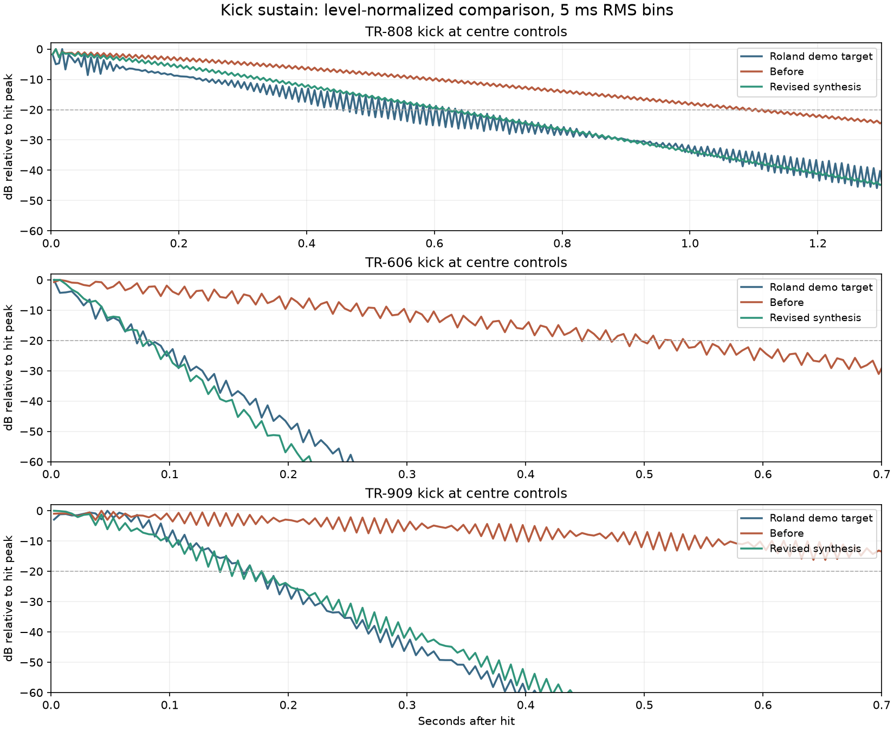

# Drum comparison: 20 October 2026

This records the initial kick investigation. The subsequent
[drum voicing pass](SYNTHS_DRUM_VOICING.md) addresses most of the additional
snare, tom, hat and cymbal gaps listed below, with separate before/after results.

The three recordings supplied from `Videos/606.mp4`, `808.mp4` and `909.mp4`
expose a real synthesis difference. The original kicks sustained excessive low
frequency energy; the discrepancy survives dry rendering and level matching.
The comparison also exposes substantial snare, tom and cymbal differences that
this kick correction does not resolve.

## Targets and method

The source is [Roland50 Studio](https://roland50.studio/). Its public drum-player
scripts load prerecorded MP3 voices. The 909 decay/snappy controls select positions
in multi-hit recordings. The 606 adds distorted/weak variants as separate rows;
those variants are excluded from the standard-voice comparison.

Matched correlation identifies the same source sounds in the supplied videos:
each kick correlates above 0.99999 after onset alignment and one gain correction.
An accent-only first step and the start-button sound must be excluded when
identifying the 808/909 kicks. The 808 snare overlaps the preceding kick's tail,
so the isolated demo target is used for that voice's spectral comparison.

The reference files are retained only under ignored local analysis directories.
They are comparison targets. The application synthesizes every drum; reference
audio and third-party synthesis code are neither imported nor deployed.

Both candidate versions are rendered directly from Wasm at 48 kHz, with centre
tune/decay/tone, full note velocity, the same levels and native effects disabled.
T20 is the last 5 ms RMS bin within 20 dB of that hit's peak. Each envelope is
normalized once; individual time bins are not gain-matched. This separates sustain
from recording volume. The sample buffers are followed by silence after playback
finishes, giving a common three-second analysis window.

The 808 target is the demo's fixed `bd1075` recording; the 909 uses its default
0.5 decay setting, and the 606 its standard bass-drum row. These are useful
comparison settings, not a complete measurement of hardware parameter laws.

## Kick correction

| Kick | Demo target T20 | Previous engine | Classic now |
| --- | ---: | ---: | ---: |
| 808 | 633 ms | 1,113 ms | 623 ms |
| 606 | 78 ms | 533 ms | 83 ms |
| 909 | 168 ms | 1,023 ms | 178 ms |



The old exponential time constants were 0.42, 0.20 and 0.34 seconds respectively.
They describe a time constant, so the audible tail extends much longer. Classic
now uses 0.24, 0.030 and 0.058 seconds. The kick's internal level is also reduced
from 1.0 to 0.75. Frequency, click generation, pitch sweep and the body waveform
are retained. This reduces sustained bass while preserving the transient.

For a second view of the excess, compare energy from 100–350 ms against the first
100 ms. The old 606 was 21.5 dB above the reference's relative late energy; the
old 909 was 13.2 dB above it. That extra energy accumulates across a rhythm.
The revised 909 is within 0.9 dB on this measure. The 606's later tail drops faster
than the target, and the 808 still differs in its attack/body balance; matching
T20 does not establish full waveform accuracy.

The Classic factory sound is now dry. The previous 25% native reverb added room
and extended tails before any outboard rack was applied. Room, Boom and the other
effected recipes remain available.

## Original bass preserved

**Deep**, appended as program 7 on every drum machine, restores the original kick
time constant and full internal level. It also retains the original Classic
ambience. The first six program IDs are unchanged. The **Kick body** selector
allows Classic or Deep to be used independently of the other sound controls.

At 48 kHz, each dry, unaccented, centre-control Deep kick was compared over three
seconds with the pre-change Wasm output. All three are **byte-for-byte identical**.
Hashes are in the measurement snapshot. The accent correction below remains
active in both modes.

The new parameter uses the original Deep character as its missing-field default.
Consequently existing saved patches and version 1/2 share links keep their old
kick sound. Current factory recipes explicitly select Classic, while the Deep
recipe selects Deep. Both choices round-trip through the existing compact format.

## Accent correction

Accent gain was added after the track level multiplication. At zero drum level,
an accented step could therefore still produce a loud voice. Accent now multiplies
the track's gain. All 34 tracks are tested for silence at zero level with maximum
accent, and the three accent strengths remain distinct.

## Other confirmed gaps

- The 808 snare takes about 218 ms to fall 20 dB, against 63 ms in the target.
  Its tonal/noise balance and noise filtering also differ.
- The 808 low tom takes about 788 ms against 208 ms. Several tom/clap/cowbell
  envelopes are likewise too long. They have not been silently retuned in this pass.
- The 808/606 hat filters allow strong lower metallic partials that the targets
  attenuate. Envelope shape, filter topology and the metal source need separate work.
- The 909 hats, crash and ride use an 808-derived metal source plus noise and
  quantization. Its closed-hat spectral centroid is about 12.8 kHz against 7.7 kHz
  in the target. Its crash and ride also share one generic cymbal algorithm.
  Roland documents the original's hats and cymbals as digital recordings in
  [The TR-909 Story](https://www.roland.com/global/promos/roland_tr-909/).
  Changing decay constants alone cannot recover those sounds. A fully synthesized
  approximation needs distinct voice designs, with the recordings used for comparison.
- There is deliberately added panning in the engine, alongside optional reverb.
  That contributes to the broad presentation independently of the kick sustain.

## Reproduce the measurement

The private reference manifest and WAVs for this workspace are in
`banks/drum-reference-2026-10-20/`. Run:

```powershell
npx.cmd vite-node tools/auditDrumReference.mjs banks/drum-reference-2026-10-20/cases.json --out .tmp/drum-reference/recheck
```

`--kernel .tmp/drum-reference/before.wasm` selects the retained pre-change kernel.
The tool writes complete resolved values, kernel/reference hashes, normalized
envelopes, spectral comparisons and synthesized WAVs. It never loads a reference
into the engine. Other local targets can use the same manifest format with
`model`, `track`, `reference`, optional `startSeconds`/`seconds` and `values`.

The retained, audio-free [measurement snapshot](measurements/drum-reference-2026-10-20.json)
records the results and source-identification correlations. Level-matched listening
comparisons in `.tmp/drum-reference/kick-ab/` play **target → before → revised**.
Their first 100 ms are level-matched once so the tail difference remains audible.
