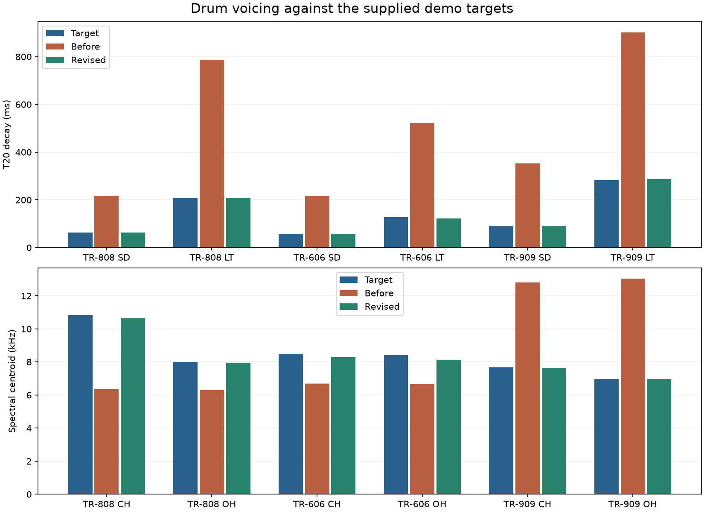

# Drum voicing follow-up: 20 October 2026

This pass tunes the three synthesized kits toward the feel of the supplied
Roland50 Studio recordings. It follows the [initial kick correction](SYNTHS_DRUM_COMPARISON.md).
The same private targets are used; no reference audio is included in an engine,
public bank or deployment.

## What changed

- Snares have shorter body/noise envelopes, a weaker second drum mode, and
  separate fixed-Hz high/low-pass noise filters. The 909 snare has a brighter
  noise band than the 808/606. Noise density is compensated for sample rate.
- Toms have shorter tails, less pitch sweep and pitches closer to the targets.
- The 808/606 hats use a shaped metal source, a resonant band-pass and additional
  high/low-pass filtering. This suppresses the low metallic buzz. Open hats use
  a held body followed by a quick closure; the 606 also has an initial decay.
- The 909 hats use band-limited noise with a small inharmonic oscillator bank.
  Crash and ride are distinct voices. Crash emphasizes a noise wash; ride uses
  an eight-mode plate with a noise strike and a quieter noise bed. The old
  broadband noise/quantized shared-cymbal approximation is removed.
- Rim modes and cowbell filtering are retuned; clap and cymbal tails are shorter.
- Compared voices are centred instead of having hidden fixed stereo offsets.
  Their Pan controls and effects remain available.
- Voice gains are balanced relative to the kit's kick using the first 100 ms
  of each target. This retains the quieter 909 hats/cymbals in the recordings.
  A single gain per kit removes the unknown recording volume; individual voices
  are not normalized independently before comparing their levels.
- Classic 808 pitch is centred at 52 Hz. Classic 606 uses a lower fundamental
  and smaller initial pitch fall. The Deep kick retains its original pitch,
  sweep, level and decay, verified against the original PCM hashes.

The metal oscillator bank now runs continuously between hits. Pausing it until
the next render block caused different hat phases at different host buffer sizes
once the shortened hats had finished. Gapped patterns on all three machines
now produce the same output with 128- and 1,024-frame buffers.

## Measured changes

Both versions use dry centre settings at 48 kHz. “Before” here is the previously
deployed engine **after** the initial kick correction. T20 is the final 5 ms RMS
bin within 20 dB of that hit's peak, so its resolution is 5 ms.

| Voice | Target T20 | Before | Revised |
| --- | ---: | ---: | ---: |
| 808 snare | 63 ms | 218 ms | 63 ms |
| 606 snare | 58 ms | 218 ms | 58 ms |
| 909 snare | 93 ms | 353 ms | 93 ms |
| 808 low tom | 208 ms | 788 ms | 208 ms |
| 606 low tom | 128 ms | 523 ms | 123 ms |
| 909 low tom | 283 ms | 903 ms | 288 ms |



The 808 closed-hat centroid moves from 6.4 to 10.7 kHz (target 10.8 kHz).
The 909 open-hat centroid moves from 13.0 to 7.0 kHz (target 7.0 kHz), and its
crash from 14.8 to 6.7 kHz (target 6.6 kHz). Centroids describe spectral balance,
not the identity of the individual partials.

Across the 29 measured voices, the median absolute error in first-100-ms level
relative to the kit's kick drops from 4.0 to 0.1 dB; the largest revised error
is 0.8 dB. This does not establish a match over the whole decay. The 808 cymbal's
late energy remains higher, for example, despite its similar T20.

The [audio-free measurement snapshot](measurements/drum-voicing-2026-10-20.json)
contains per-voice before/target/after values and kernel hashes.
`src/synths/engine/drumReferenceTargets.json` holds independent target measurements
for regression tests at 44.1, 48 and 96 kHz. Tolerances accommodate noise, finite
FFT resolution and the intended approximation, while detecting the old long
tails, wrong spectral balance and excessive 909 cymbal levels.

## Preservation and limits

**Deep** remains program 7, with the original bass drum. Each dry, unaccented
centre-control kick is still byte-for-byte identical to its pre-correction
three-second render. The dedicated checksum test guards this. Other kit voices
are revoiced in all sound recipes, including saved patches and Deep; the
Kick body selector controls the bass drum independently.

These are synthesized approximations tuned to fixed demo settings. They do not
reproduce the original sample ROM or prove component-level accuracy. Cymbal
modal detail, snare noise texture, clap burst timing and parameter laws across
the full knob ranges remain approximate. The 808 congas, claves and maracas
were absent from the supplied comparison sequence and are not calibrated here.
The 909 ride's centroid remains lower and its T20 about 45 ms shorter than the
target. External rack effects can substantially change this dry comparison.

To reproduce with the retained private targets:

```powershell
npx.cmd vite-node tools/auditDrumReference.mjs banks/drum-reference-2026-10-20/cases.json --out .tmp/drum-reference/recheck
```

Use `--kernel .tmp/drum-reference/vibe-before.wasm` for the previous deployed
kernel. The reference manifest documents the selected demo recordings and
the limitations of their knob settings.
